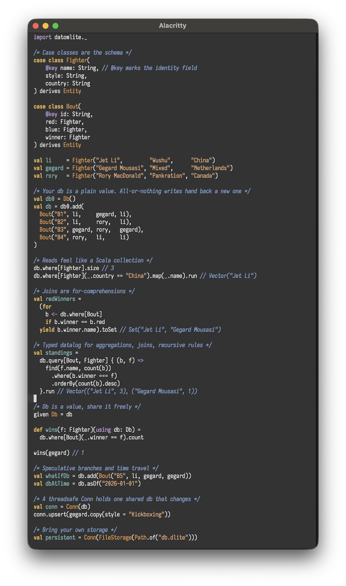

<div align="right">
  <sub><em>part of <a href="https://github.com/mattlianje/cabinet6">c6</a></em></sub>
</div>

#  datomlite

**Lightweight, immutable database**

**datomlite** is a zero-dep "DB-as-a-value" you can drop into your Scala 3 apps to store and
retrieve your case classes.

<p align="center">
  
</p>

- Zero deps, pure Scala 3.7+
- Cross-platform (JVM, JS, Native)
- Case classes are "the schema"
- Append-only log: every past state stays queryable
- Typed queries, compile-time checked
- Datalog that feels like plain Scala (no EDN, no DDL)
     - Joins, refs, aggregations, window functions, recursive rules
- The `Db` is a plain immutable value: every write hands back a new one
- A `Conn` when you want one shared, changing db (threads, listeners, live queries)
- Easy time-travel and speculative transactions
- Named-tuple query results
- Implement `Storage` and bring your own backend

```scala
"xyz.matthieucourt" %% "datomlite" % "0.1.0"
```

All you need:
```scala
import datomlite._
```

Try it in your REPL:
```
 scala-cli repl --dep xyz.matthieucourt::datomlite:latest.release
```

## Contents
- [Quick start](#quick-start)
- [Cheatsheet](#cheatsheet)
- [How it works](#how-it-works)
- [FAQ](#faq)
- [Example schema](#example-schema)
- Model your data
  - [Mark keys and unique fields](#mark-keys-and-unique-fields)
  - [Link entities with refs](#link-entities-with-refs)
  - [Leave fields out with `Option`](#leave-fields-out-with-option)
  - [Store your own types with codecs](#store-your-own-types-with-codecs)
- [Write data](#write-data)
  - [Add data](#add-data)
  - [Update data](#update-data)
  - [Remove data](#remove-data)
  - [Batch several writes into one tx](#batch-several-writes-into-one-tx)
- [Read data](#read-data)
  - [Get one entity](#get-one-entity)
  - [List, filter and count entities](#list-filter-and-count-entities)
  - [Write filters that use the index](#write-filters-that-use-the-index)
  - [Shape results with pull](#shape-results-with-pull)
    - [Follow refs backwards](#follow-refs-backwards)
  - [Run queries](#run-queries)
    - [Join with a for-comprehension](#join-with-a-for-comprehension)
    - [Write typed queries](#write-typed-queries)
    - [Get rows as named tuples](#get-rows-as-named-tuples)
    - [Aggregate rows](#aggregate-rows)
    - [Sort and page results](#sort-and-page-results)
  - [Exclude matches with `not`](#exclude-matches-with-not)
  - [Check that a match exists](#check-that-a-match-exists)
  - [Rank and total with window functions](#rank-and-total-with-window-functions)
  - [Reuse logic with rules](#reuse-logic-with-rules)
    - [Walk a tree or graph (`Rule.reaches`)](#walk-a-tree-or-graph-rulereaches)
    - [Match any of several conditions (`Rule[A, B]`)](#match-any-of-several-conditions-rulea-b)
    - [Write recursive rules (`Rule.recursive`)](#write-recursive-rules-rulerecursive)
- [Travel back in time](#travel-back-in-time)
  - [See every change to an entity](#see-every-change-to-an-entity)
  - [Diff two dbs](#diff-two-dbs)
- [Share a changing db with `Conn`](#share-a-changing-db-with-conn)
  - [React to every commit](#react-to-every-commit)
  - [Keep a query result up to date](#keep-a-query-result-up-to-date)
  - [Save to disk or your own backend](#save-to-disk-or-your-own-backend)
  - [Read and write from many threads](#read-and-write-from-many-threads)
- [Print the state and the log](#print-the-state-and-the-log)
- [Build / Contribute](#build--contribute)

## Quick start

```scala
import datomlite._

/* Just derive `Entity` on your case classes */
case class Person(@key email: String, name: String) derives Entity

/* A db is a value */
val db = Db(Person("m@x.io", "Matt"), Person("a@x.io", "Alice"))

/* Your db feels like a collection */
db.where[Person].run
db.where[Person].size
db.where[Person](_.email == "m@x.io").one
db.where[Person].filter(_.name.startsWith("M")).take(5).toList
for p <- db.where[Person] do println(p.name)

/* Writes hand back a new db */
val db2 = db.upsert(Person("m@x.io", "Matthieu"))

/* Typed Datalog: joins, projections, aggs */
db2.query[Person] { p =>
  find(p.name) where (p.email === "m@x.io")
}.run

/* Hold a shared mutable DB in a Conn */
val conn = Conn(db2)
conn.retractWhere[Person](_.email == "m@x.io")
conn.db.where[Person].run
```

## Cheatsheet
```
db.where[A](pred)                  rows of A, like a collection
db.query[A, B] { ... }             joins, projections, aggregations, rules
.pull(f)                           nested output, walks refs
db.add / upsert / retractWhere     writes, each hands back a new db
db.tx { b => ... }                 several writes in one tx
db.asOf / history / diff           past states
Conn(db)                           one shared db: listen, watch, storage
db.pretty                          print the live state
```

## How it works
Under the hood, **datomlite** is an append-only log of (eid, attr, value) triples with a few in-memory indices
There are some macros that shred your case classes into triples on write and rebuilt on read, so you never really have to think about them.

The indices are EAVT, AVET, and a class index (every entity of a given type). They're all derived from the log.

For a quick example, suppose we add two pugilists to our database, "Jet Li" and "Masvidal". Adding them appends datoms and the live projection picks them up:

```scala
import datomlite._

case class Fighter(
  fName: String,
  lName: String,
  nickname: Option[String]
) derives Entity

val db = Db(
  Fighter("Jorge", "Masvidal", Some("Street Judas")),
  Fighter("Jet",   "Li",       None),
)
```

<p align="center">
  
</p>

Unsurprisingly, we want to remove Masvidal:
```scala
val db2 = db.retractWhere[Fighter](_.lName == "Masvidal")
db2.where[Fighter].run
// Vector(Fighter("Jet", "Li", None))
```
The new db doesn't show Masvidal anymore, but the log still has everything (and the old db still has him).

<p align="center">
  
</p>

## FAQ

**Why datomlite?**<br>
First, for good-spirited fun and happy hacking. Second, I have long wanted a datastore "as-a-value" I can drop into my processes and throw my case classes
at, without first carving EDN, registering attributes, or learning a finicky ersatz Datalog DSL.

**Does it support all of Datalog?**<br>
No. Recursion goes through named rules, negation is top-level conjunctions only, and there is no built-in unification beyond the DSL.

**Differences from Datomic / Datascript?**<br>
- Case classes are "the schema". There is no `:db/ident`, no attribute registration or otherwise separate cardinality/uniqueness facts.
- Queries are typed Scala, not vectors of triples.
- Single-process. Writes to a `Conn` are serialized, and there is no peer/transactor, no client API

**`Db` or `Conn`?**<br>
A Db is an immutable value. Every write gives you a new one and leaves the old one alone, which is all you need for tests, what-ifs and
time travel. A Conn holds the current Db and swaps in a new one on each commit. Use it when several threads write to the same db, or when
you want to listen for changes.

**Transaction guarantees?**<br>
- **Atomicity.** All writes in a tx land together, or none do.
- **Values.** A Db never changes, so reads never lock or block, and always see one consistent state.
- **Serialized commits.** Any number of threads can write to a Conn. Commits run one at a time, in order.
- **Atomic read-modify-write.** Writes that read first (predicate writes, tx blocks, tx fns) do that read inside the commit.
- **Write-ahead.** A commit hits storage before it's visible on the Conn. If anything throws, the tx aborts and no listener fires.

**Inspiration?**<br>
Although **datomlite** borrows ideas from [Datomic](https://www.datomic.com/), [Datascript](https://github.com/tonsky/datascript), [Mentat](https://github.com/mozilla/mentat) and [XTDB](https://xtdb.com/) and is in the general orbit of Datalog flavoured triple stores, it puts particular (and to my knowledge novel) emphasis on type-safety and feeling 100% embedded into the host language. 


## Example schema
The examples below use these plain domain entities...

```scala
case class Department(@key code: String, name: String) derives Entity
case class Skill(@key name: String) derives Entity
case class Order(buyer: String, item: String, price: Long) derives Entity

case class Employee(
  @key email: String,
  name: String,
  dept: Department,
  salary: Long,
  skills: Set[Skill] = Set.empty,
  nickname: Option[String] = None
) derives Entity
```

...and this db, unless an example says otherwise:

```scala
val eng = Department("ENG", "Engineering")
val ops = Department("OPS", "Operations")
val sc  = Skill("Scala")
val hs  = Skill("Haskell")

val db = Db(
  Employee("m@x.io", "Matt",  eng, 120_000L, Set(sc, hs)),
  Employee("a@x.io", "Alice", eng, 110_000L, Set(sc)),
  Employee("b@x.io", "Bob",   ops, 150_000L),
  Order("m@x.io", "book",  20L),
  Order("m@x.io", "pen",    5L),
  Order("a@x.io", "lamp",  90L),
  Order("b@x.io", "chair", 60L),
)
```

## Mark keys and unique fields
Mark a field `@key` to make it the entity's identity (it's what `upsert` matches on). Use `@unique` for fields that just can't repeat.
```
@key                   identity field
@unique                must be unique across the entity
db.upsert(values*)     find by key, retract prior, re-assert under same eid
.key(f)                chained, computed or composite key
.unique(f)             chained, additional unique field
.named("...")          chained, override the attribute prefix
```

A duplicate throws `UniqueViolation` and nothing gets written.

```scala
case class User(
  @key email: String,
  @unique handle: String,
  name: String
) derives Entity

val db = Db(User("a@x.io", "shared", "Alice"))
db.add(User("b@x.io", "shared", "Bob"))
// UniqueViolation: 'shared' is taken
```

> [!NOTE]  
> For a computed or composite key, write the given yourself:
```scala
case class Friend(a: Person, b: Person)
given Entity[Friend] = Entity.derived[Friend].key { f =>
  val Seq(x, y) = Seq(f.a.email, f.b.email).sorted
  (x, y)
}
```

Two classes with the same name in different packages will clash. Use `.named` to tell them apart:
```scala
given Entity[a.Person] = Entity.derived[a.Person].named("a.Person").key(_.email)
given Entity[b.Person] = Entity.derived[b.Person].named("b.Person").key(_.email)
```

## Link entities with refs
To point one entity at another, just use it as a field type. Cardinality comes from the Scala type, so there's no separate declaration
to keep in sync (a bit opinionated, I know).

```
T          one datom per row
Option[T]  one datom on Some, nothing on None
Set[T]     one datom per element
R          one datom holding the target's eid (R needs an Entity and a @key)
Option[R]  one target eid on Some, nothing on None
Set[R]     one datom per target eid
```

In queries, `===` joins across refs, single or many:

```scala
db.query[Employee, Department, Skill] { (e, d, s) =>
  find(e.email, s.name) where (
    e.dept === d &&
      d.name === "Engineering" &&
      e.skills === s
  )
}.run // Vector(("m@x.io","Scala"), ("m@x.io","Haskell"), ("a@x.io","Scala"))
```

## Leave fields out with `Option`
Use Option for fields that can be missing. None just means no datom gets written, there's no stored null.

```scala
val eng = Department("ENG", "Engineering")

val db = Db(
  Employee("m@x.io", "Matthieu", eng, 120_000L, nickname = Some("Matt")),
  Employee("a@x.io", "Alice",    eng, 110_000L),
)

db.where[Employee](_.nickname.contains("Matt")).run.map(_.email)
// Vector("m@x.io")

db.where[Employee](_.nickname == None).run.map(_.email)
// Vector("a@x.io")
```

In a typed query, `find(e.nickname)` gives you the inner value and skips the Nones:

```scala
db.query[Employee] { e =>
  find(e.email, e.nickname)
}.run
// Vector(("m@x.io", "Matt"))
```

An Option of an entity is an optional ref, and works how you'd expect:

```scala
case class Mentor(
  @key email: String,
  name: String,
  mentor: Option[Mentor] = None
) derives Entity

val ann = Mentor("ann@x.io", "Ann")
val db = Db(Mentor("bo@x.io", "Bo", Some(ann)))

db.where[Mentor](_.mentor.contains(ann)).run.map(_.name) // Vector("Bo")
db.where[Mentor](_.mentor.isEmpty).run.map(_.name)       // Vector("Ann")
```

## Store your own types with codecs
Datoms only store strings, numbers, booleans and vectors of those. Anything else goes through a `Codec`. The usual suspects (UUIDs, dates,
collections, options, tuples...) already have one. For your own types, add `derives Codec` or write one with `Codec.of`:

```scala
enum Tier derives Codec:
  case Free, Pro

case class Address(street: String, city: String) derives Codec

case class Money(cents: Long)
given Codec[Money] = Codec.of[Money, Long](_.cents, Money(_))

case class Account(
  @key id: UUID,
  tier: Tier,
  home: Address,
  fee: Money,
  limits: Map[String, Int]
) derives Entity
```

These get stored as:
```
Tier.Pro                   "Pro"
Address("1 Main", "Paris") Vector("street", "1 Main", "city", "Paris")
Money(250)                 250L
Map("a" -> 1)              Vector(Vector("a", 1))   /* entries sorted */
```

You still query with your own types, the encoding is done for you:

```scala
db.where[Account](_.tier == Tier.Pro).run   /* AVET probe on "Pro" */
db.query[Account](a => find(a.home) where (a.fee === Money(250))).run
// Vector(Address("1 Main", "Paris"))
```

> [!NOTE]
> Comparisons, sorting and min/max run on the stored form. So an enum sorts by case name, not by ordinal.

### Store dates and times
`Time` is a UTC instant and `Date` is a calendar day. Both are stored as numbers, so they sort properly and range lookups use the index.

```scala
case class Task(@key id: String, due: Date, doneAt: Option[Time]) derives Entity

val d = Date.of(2026, 10, 13)     /* or Date.parse("2026-10-13"), Date.today() */
d.plusDays(7).iso                 /* "2026-10-20" */
Date.at(Time.now())               /* the UTC day of an instant */

db.where[Task](_.due < Date.today()).run  /* index slice, not a scan */
```

## Write data
Every write is all-or-nothing and gives you a new db. On a Conn, the same methods commit in place and return a TxReport.

```
db.add(values*)              assert one or more rows in one tx
db.retract(values*)          retract by full equality, misses are silent
db.upsert(values*)           assert, replacing whatever holds the same key
db.retractWhere[A](pred)     find every match and retract in one tx
db.upsertWhere[A](pred)(f)   find every match, apply f and upsert in one tx
db.tx { b => ... }           several ops in one tx
db.transact(tx)              apply a Tx value, get a TxReport back
```

## Add data
`db.add` takes one or more rows, of any type, in one tx:

```scala
val db2 = db.add(
  Employee("c@x.io", "Carol", eng, 95_000L),
  Order("c@x.io", "desk", 200L),
)
```

If the key is already taken it throws `UniqueViolation`. Use `upsert` if you want to replace.

## Update data
If you have the new version of a row, `upsert` it. It replaces whatever has the same key, and refs to it keep working:

```scala
val renamed = db.upsert(Department("ENG", "Platform"))
/* Matt's and Alice's dept now reads "Platform" */
```

To change rows based on what's there now, use `upsertWhere`. The read and the write happen in one tx:

```scala
val raised = db.upsertWhere[Employee](_.email == "m@x.io") { e =>
  e.copy(salary = e.salary + 5_000L)
}
```

## Remove data
`retractWhere` removes everything matching a predicate. `retract` removes exact values (and ignores misses):

```scala
val fewer = db2
  .retractWhere[Employee](_.email == "c@x.io")
  .retractWhere[Order](_.buyer == "c@x.io")

val noDesk = db2.retract(Order("c@x.io", "desk", 200L))
```

Note that `fewer` is two txs. Use a [tx block](#batch-several-writes-into-one-tx) if you want one.

Removed rows stay in the log, so you can still get at them with [time travel](#travel-back-in-time).

## Batch several writes into one tx
When several writes belong together, put them in one tx so they all land or none do.
```
db.tx { b => ... }            mixed add/retract/upsert in one tx
b.add / b.retract / b.upsert  inside the block
b.retractWhere[A](pred)       finds matches, appends a retract
b.upsertWhere[A](pred)(f)     reads matches, applies f, appends an upsert
db.retractWhere /             one-shot tx versions
db.upsertWhere(pred)(f)  
Tx.batch(steps*)              hold steps as a value
Tx.fn(db => tx)               a step computed from the state-so-far

Tx.block / Tx.retractWhere   the same, as Tx values
Tx.upsertWhere
   
db.transact(tx)               apply a Tx value
```

Steps run in order and share one tx id. The block runs inside the commit, so on a Conn no other writer can sneak in between your reads
and writes. `b.db` is the db so far, earlier steps included.

```scala
val raised = db.tx { b =>
  val m = b.db.where[Employee](_.email == "m@x.io").one.get
  b.upsert(m.copy(salary = m.salary + 5_000L))
}
```

> [!NOTE]
> On a Conn other writers wait while the block runs, so keep it short. Calling `conn.add` or `conn.transact` inside it throws, use `b` instead.

You can mix any kind of write in a block:
```scala
val db2 = db.tx { b =>
  b.upsertWhere[Employee](_.email == "m@x.io")(_.copy(name = "Matthieu"))
  b.add(Order("m@x.io", "book", 20L))
}

val db3 = db.tx { b =>
  b.retractWhere[Order](_.buyer == "ghost@x.io")
  b.upsertWhere[Employee](_.email == "m@x.io")(_.copy(salary = 130_000L))
}
```

A tx can also be a plain value you build now and apply later:
```scala
val tx = Tx.batch(
  Tx.add(Order("m@x.io", "book", 20L)),
  Tx.add(Order("m@x.io", "pen",   5L)),
)
val rep = db.transact(tx)
```

If a step depends on the data at commit time, use `Tx.fn`. It runs when the tx commits, not when you build it:
```scala
case class Counter(@key name: String, n: Long) derives Entity

val bump = Tx.fn { s =>
  val hits = s.where[Counter](_.name == "hits").run
  Tx.upsert(hits.map(c => c.copy(n = c.n + 1))*)
}

val counted = db.transact(Tx.batch(Tx.add(Counter("hits", 0)), bump)).dbAfter
counted.where[Counter].one   // Some(Counter("hits", 1))
```

`transact` gives back a TxReport:
```
tx, time, adds, retracts, addedEids, datoms, dbBefore, dbAfter
```
You can pass `tx` or `time` to [`asOf`](#travel-back-in-time) later.

## Read data
`db.where[A]` gives you a lazy `Query[A]`. Call `.run` for a Vector or `.one` for an Option. Since a db never changes, every read on the
same db sees the same state.

```
db.where[A]             Query[A] over all rows of A
db.where[A](pred)       Query[A] filtered, probes the index where it can
db.exists[A](pred)      Boolean, short-circuits
db.count[A](pred)       Long, no row materialization
.run / .one             materialize to Vector / Option
```

## Get one entity
Filter on the key and call `.one`:

```scala
db.where[Employee](_.email == "m@x.io").one    // Some(Employee("m@x.io", "Matt", ...))
db.where[Employee](_.email == "zz@x.io").one   // None
```

Got a raw eid instead? Use [`byEid`](#shape-results-with-pull).

## List, filter and count entities
`.run` gives you every match. `exists` and `count` don't build the rows at all:

```scala
db.where[Employee].run                            // Vector[Employee]
db.where[Employee](_.name.startsWith("M")).run    // Vector[Employee]
db.where[Employee](_.salary >= 120_000L).run      // Vector[Employee]

db.exists[Employee](_.email == "m@x.io")     // true
db.count[Employee](_.name.startsWith("M"))   // 1
db.count[Employee]                           // 3

/* Still feels like a collection */
db.where[Employee].toList
db.where[Employee].size
db.where[Employee].head
for e <- db.where[Employee] do println(e.name)
```

## Write filters that use the index
Predicates look like normal collection filters, but the macros turn equality, comparisons and `startsWith` into index lookups, so most
filters never scan.

```scala
/* index, range and prefix probes */
db.where[Employee](_.email == "m@x.io").run
db.where[Employee](_.salary >= 120_000L).run
db.where[Employee](_.name.startsWith("M")).run

/* a range bounded on both sides */
db.where[Employee](e => e.salary > 100_000L && e.salary <= 150_000L).run

/* probe on the prefix, then filter */
db.where[Employee](e => e.name.startsWith("M") && e.name.length > 4).run

/* a scan */
db.where[Employee](_.name.matches("M.*")).run
```

The value index is sorted, so comparisons and `startsWith` only read the slice they need. In an `&&`, an equality wins, otherwise the
tightest range is used and the rest filters that slice. `||`, regex and arbitrary code fall back to a scan. You always get the right
answer, only the speed changes. The same goes for [typed queries](#write-typed-queries).

Predicates can follow refs too:
```scala
db.where[Employee](_.email == "m@x.io").one.get.dept.name
db.where[Employee](_.dept.name == "Engineering").run // <-- two index lookups, no scan
db.where[Employee](_.dept == Department("ENG", "Engineering")).run
```

`.contains` on a Set field also uses the index:
```scala
case class Tagged(
  @key name: String,
  tags: Set[String]
) derives Entity

val tdb = Db(
  Tagged("matt", Set("fp", "scala")),
  Tagged("ali",  Set("ml")),
)

tdb.where[Tagged](_.tags.contains("fp")).run.map(_.name) // Vector("matt")
```

## Shape results with pull
Pull lets you pick exactly what comes back, following refs into nested shapes. Handy for nested output without a join, or for grabbing a
few fields of a big entity.

```
.pull(f) / .pullOne(f)    project rows through Pull[A]
db.byEid[A](eid)          reconstruct an entity from a raw eid
db.pullByEid[A](eid)(f)   pull by raw eid
p.field                   read a single attribute
p.refField(sub)           nested pull through a card-1 ref
p.value                   reconstruct the whole entity
p.reverse[E](_.field)     walk a ref backwards, MultiPull[E]
```

```scala
db.where[Employee](_.email == "m@x.io").pullOne(_.dept(_.name))
// Some("Engineering")

db.where[Employee](_.dept.name == "Engineering").pull(e => (e.email, e.name))
// Vector(("m@x.io", "Matt"), ("a@x.io", "Alice"))
```

With a raw eid (say from `addedEids`):

```scala
val rep = db.transact(Tx.add(Employee("d@x.io", "Dan", eng, 90_000L)))
val eid = rep.addedEids.head
val db2 = rep.dbAfter

db2.byEid[Employee](eid)
// Some(Employee(...))

db2.pullByEid[Employee](eid)(e => (e.name, e.dept(_.name)))
// Some(("Dan", "Engineering"))
```

Both return None if the eid isn't there or is a different type.

### Follow refs backwards
`reverse` finds everything pointing at a row. Here, everyone in ENG:

```scala
db.where[Department](_.code == "ENG")
  .pullOne(d => d.reverse[Employee](_.dept).map(_.name))
// Some(Vector("Matt", "Alice"))
```

It nests like everything else:

```scala
db.where[Department](_.code == "ENG").pullOne { d =>
  (d.name, d.reverse[Employee](_.dept).map(e => (e.name, e.skills.map(_.name))))
}
// Some((
//   "Engineering",
//   Vector(
//     ("Matt",  Vector("Scala", "Haskell")),
//     ("Alice", Vector("Scala")),
//   ),
// ))
```

Without it you'd write a flat query, regroup it by hand, and lose anyone with no skills to the inner join:

```scala
val triples = db.query[Department, Employee, Skill] { (d, e, s) =>
  find(e.name, s.name) where (
    d.code === "ENG" && e.dept === d && e.skills === s
  )
}.run
// Vector(("Matt", "Scala"), ("Matt", "Haskell"), ("Alice", "Scala"))
```

## Run queries
You can query two ways: a plain for-comprehension over `where` for simple joins, or `db.query` for everything else (projections, joins,
aggregations, windows, rules), with field names checked at compile time.

### Join with a for-comprehension
Just a normal for-comprehension, no DSL:

```scala
(for
  e <- db.where[Employee]
  o <- db.where[Order](_.buyer == e.email)
yield (e.name, o.item)).run
// Vector(("Matt", "book"), ("Matt", "pen"),
//        ("Alice", "lamp"), ("Bob", "chair"))
```

> [!NOTE]
> Each join here is a nested loop. For anything bigger, use `db.query`.

### Write typed queries
Each type parameter binds a row, `find` picks what to return and `where` (optional) filters. Combine with `&&` and `||`, and compare with
`===`, `!==`, `<`, `>=` and so on.

```scala
db.query[Employee] { e =>
  find(e.name) where (e.email === "m@x.io")
}.run
// Vector("Matt")

db.query[Employee] { e =>
  find(e.name)
}.run
// Vector("Matt", "Alice", "Bob")
```

Each side of an `||` runs separately, so add `.distinct` if you don't want duplicates:

```scala
db.query[Employee] { e =>
  find(e.name) where (e.email === "m@x.io" || e.email === "b@x.io")
}.run
// Vector("Matt", "Bob")
```

Join on a ref, or on any two fields:

```scala
db.query[Employee, Department] { (e, d) =>
  find(e.email, d.name) where (
    e.dept === d &&
      d.name === "Engineering"
  )
}.run
// Vector(("m@x.io","Engineering"), ("a@x.io","Engineering"))

db.query[Employee, Order] { (e, o) =>
  find(e.name, o.item) where (
    e.email === o.buyer && o.price > 50L
  )
}.run
// Vector(("Alice","lamp"), ("Bob","chair"))
```

Typos don't compile, and the error lists the real fields:
```scala
db.query[Employee] { e => find(e.emial) where (e.email === "x") }
// does not compile: `emial` is not a field of Employee.
// Available: email, name, dept, salary, skills, nickname
```

Reusable conditions are just functions returning a `Constraint`:
```scala
def engineers(d: Row[Department]): Constraint = d.name === "Engineering"
def expensive(e: Row[Employee], min: Long): Constraint = e.salary > min

db.query[Employee, Department] { (e, d) =>
  find(e.email) where (
    engineers(d) && expensive(e, 100_000L) && e.dept === d
  )
}.run
```

### Get rows as named tuples
Name the arguments to `find` and you get named tuples back:

```scala
val rows = db.query[Employee, Department] { (e, d) =>
  find(name = e.name, dept = d.name, salary = e.salary)
    .where(e.dept === d)
    .orderBy(e.salary.desc)
}.run
// Vector[NamedTuple[("name","dept","salary"), (String, String, Long)]]

rows.head.name          // "Bob"
rows.map(_.salary).sum  // 380000L
```

And you can match on them by name:
```scala
for case (name = n, salary = s) <- rows if s > 100_000L
yield s"$n earns $s"
```

### Aggregate rows
Put an aggregate in `find` and the other terms become the group key:

```
count(t) / countDistinct(t)    Long
sum(t) / avg(t)                Numeric[T]
min(t) / max(t)                Ordering[T]
```

```scala
db.query[Employee, Order] { (e, o) =>
  find(e.name, sum(o.price)) where (e.email === o.buyer)
}.run
// Vector(("Matt",25), ("Alice",90), ("Bob",60))
```

For a single entity type, you can stay in plain Scala:

```
Query[A].groupBy(f)    Map[K, Vector[A]] with .agg extension
Query[A].countBy(f)    Map[K, Long]
```

```scala
db.where[Order].groupBy(_.buyer).agg(_.map(_.price).sum)
// Map("m@x.io" -> 25, "a@x.io" -> 90, "b@x.io" -> 60)

db.where[Order].countBy(_.buyer)
// Map("m@x.io" -> 2, "a@x.io" -> 1, "b@x.io" -> 1)
```

### Sort and page results
Sort and slice right on the query:

```
.orderBy(term.asc | term.desc, ...)   typed query, keys must be in find(...)
.orderBy(f) / .orderByDesc(f)         where[A] surface, by selector
.limit(n) / .offset(n)
```

```scala
db.query[Employee] { e =>
  find(e.name, e.salary)
    .where(e.salary > 100_000L)
    .orderBy(e.salary.desc)
    .limit(2)
}.run
// Vector(("Bob",150000), ("Matt",120000))

db.where[Employee].orderBy(_.salary).limit(2).run
db.where[Order].orderByDesc(_.price).offset(10).limit(10).run
```

## Exclude matches with `not`
`not` keeps the rows where the inner condition finds no match (an anti-join):

```scala
/* employees with no orders */
db.query[Employee, Order] { (e, o) =>
  find(e.name) where not(e.email === o.buyer)
}.run
```

`not` has to sit at the top level of an `&&` chain (no `||` around it, no double `not`), and anything used inside it must also be bound
outside it.

## Check that a match exists
Sometimes you only care that a match exists, not what it is (a semi-join). That's what `exists` is for:

```scala
/* orders whose buyer exists as a registered Employee */
db.query[Order] { o =>
  find(o.item) where exists[Employee] { e => e.email === o.buyer }
}.run
```

## Rank and total with window functions
Window functions rank or total rows per group without collapsing them:

```scala
db.query[Employee, Department] { (e, d) =>
  find(
    d.name,
    e.name,
    e.salary,
    rank()           over partitionBy(d).orderBy(e.salary.desc),
    sum(e.salary)    over partitionBy(d)
  ).where(e.dept === d)
}.run
```

```
rowNumber()                          Long       1-indexed, needs orderBy
rank()                               Long       ties share rank, then skip
denseRank()                          Long       ties share rank, no gaps
lag(t, n = 1) / lead(t, n = 1)       Option[T]  None past the partition edge
sum/min/max/avg/count(t).over(spec)  as input   broadcast over the partition
```

```scala
db.query[Employee, Department] { (e, d) =>
  find(d.name, e.name, rowNumber() over partitionBy(d).orderBy(e.salary.desc))
    .where(e.dept === d)
    .orderBy(d.name.asc)
}.run.filter(_._3 == 1L) // top earner per dept
```

## Reuse logic with rules
A `Rule[A, B]` is a named, reusable condition between two rows. With several bodies it matches if any of them does, and a body can call
the rule itself to recurse.

```
Rule.reaches[A](_.field)              transitive closure of one self-ref field
Rule[A, B](bodies*)                   multi-body Datalog without recursion
Rule.recursive[A, B] { self => ... }  recursive Datalog, naive fixed-point
rule(src, dst)                        call inside any where(...)
```

### Walk a tree or graph (`Rule.reaches`)
`Rule.reaches` follows a self-referencing field all the way down:

```scala
case class Node(
  @key id: String,
  children: Set[Node]
) derives Entity

val d = Node("d", Set.empty)
val c = Node("c", Set(d))
val a = Node("a", Set(c))
val b = Node("b", Set.empty)
val db = Db(Node("root", Set(a, b)))

val reachable: Rule[Node, Node] = Rule.reaches[Node](_.children)

db.query[Node, Node] { (s, t) =>
  find(t.id) where (s.id === "root" && reachable(s, t))
}.run.toSet
// Set("a", "b", "c", "d")
```

### Match any of several conditions (`Rule[A, B]`)
A pair matches if any body holds. Here a user can read their own docs, public docs, or anything if they're an admin:

```scala
case class User(@key email: String, role: String) derives Entity
case class Doc(@key slug: String, owner: String, public: Boolean) derives Entity

val canRead: Rule[User, Doc] = Rule[User, Doc](
  (u, d) => d.owner === u.email,
  (u, d) => d.public === true,
  (u, d) => u.role === "admin"
)

db.query[User, Doc] { (u, d) =>
  find(u.email, d.slug) where canRead(u, d)
}.run
```

### Write recursive rules (`Rule.recursive`)
The closure gets the rule itself as `self`, so bodies can recurse. It always terminates, since there's only so many facts.

Say we have a chain of command...
<p align="center">
  
</p>

```scala
case class Off(
  @key name: String,
  boss: Option[String]
) derives Entity

val db = Db(
  Off("Napoléon", None),
  Off("Davout",   Some("Napoléon")),
  Off("Ney",      Some("Napoléon")),
  Off("Murat",    Some("Napoléon")),
  Off("Friant",   Some("Davout")),
  Off("Gudin",    Some("Davout")),
  Off("Lasalle",  Some("Murat")),
  Off("Marchand", Some("Ney")),
)

val ancestor: Rule[Off, Off] =
  Rule.recursive[Off, Off] { self =>
    Seq(
      (anc, desc) => desc.boss === anc.name,
      (anc, desc) => exists[Off] { mid =>
        desc.boss === mid.name && self(anc, mid)
      }
    )
  }
```

**Find everyone under Davout:**
<p align="center">
  
</p>

```scala
db.query[Off, Off] { (anc, desc) =>
  find(desc.name) where (anc.name === "Davout" && ancestor(anc, desc))
}.run.toSet
// Set("Friant", "Gudin")
```

**Find everyone above Lasalle:**
<p align="center">
  
</p>

```scala
db.query[Off, Off] { (anc, desc) =>
  find(anc.name) where (desc.name === "Lasalle" && ancestor(anc, desc))
}.run.toSet
// Set("Murat", "Napoléon")
```

In SQL, the first one is a recursive CTE:

```sql
WITH RECURSIVE ancestor(anc, desc) AS (
  SELECT boss, name FROM off WHERE boss IS NOT NULL
  UNION
  SELECT a.anc, o.name
  FROM ancestor a JOIN off o ON o.boss = a.desc
)
SELECT desc FROM ancestor WHERE anc = 'Davout';
```

#### Find every reachable city (directed graph)

<p align="center">
  
</p>

```scala
case class Place(@key code: String) derives Entity

case class Road(
  from: Place,
  to: Place
)
given Entity[Road] = Entity.derived[Road].key(r => (r.from.code, r.to.code))

def road(a: String, b: String) = Road(Place(a), Place(b))

val db = Db(
  road("PAR", "LYO"),
  road("LYO", "MAR"),
  road("MAR", "PAR"),   // cycle
  road("LYO", "NCE"),
  road("PAR", "BOR"),
)

val reachable: Rule[Place, Place] =
  Rule.recursive[Place, Place] { self =>
    Seq(
      (s, t) => exists[Road] { r => r.from === s && r.to === t },
      (s, t) => exists[Place] { mid =>
        exists[Road] { r => r.from === s && r.to === mid } && self(mid, t)
      }
    )
  }

/* Everywhere reachable from Paris. The cycle means PAR reaches itself */
db.query[Place, Place] { (s, t) =>
  find(t.code) where (s.code === "PAR" && reachable(s, t))
}.run.toSet
// Set("LYO", "MAR", "PAR", "NCE", "BOR")
```

#### Find everyone in a friend group (undirected graph)

<p align="center">
  
</p>

```scala
case class Person(@key handle: String) derives Entity

case class Friend(
  a: Person,
  b: Person
)
given Entity[Friend] = Entity.derived[Friend].key { f =>
  val Seq(x, y) = Seq(f.a.handle, f.b.handle).sorted
  (x, y)
}

def edge(x: String, y: String) = Friend(Person(x), Person(y))

val db = Db(
  edge("alice", "bob"),
  edge("alice", "carol"),
  edge("bob",   "dave"),
  edge("carol", "dave"),
  edge("dave",  "erin"),
  edge("frank", "grace"),
)

/* `knows` is symmetric, two bodies one per orientation */
val knows: Rule[Person, Person] =
  Rule[Person, Person](
    (x, y) => exists[Friend] { f => f.a === x && f.b === y },
    (x, y) => exists[Friend] { f => f.a === y && f.b === x }
  )

/* `connected` is the closure over `knows`, like `ancestor` */
val connected: Rule[Person, Person] =
  Rule.recursive[Person, Person] { self =>
    Seq(
      (x, y) => knows(x, y),
      (x, y) => exists[Person] { mid => knows(x, mid) && self(mid, y) }
    )
  }

/* Alice's cluster */
db.query[Person, Person] { (x, y) =>
  find(y.handle) where (x.handle === "alice" && connected(x, y))
}.run.toSet
// Set("bob", "carol", "dave", "erin")

/* Frank is in a separate component */
db.query[Person, Person] { (x, y) =>
  find(y.handle) where (
    x.handle === "alice" && y.handle === "frank" && connected(x, y)
  )
}.run
// Vector()
```

## Travel back in time
Every db keeps its whole log, so you can look at it as it was at any point. And since writes return a new db, a what-if is just a write
you don't keep.

```
db.asOf(tx)               rewind to a tx id
db.asOf(time)             rewind to a Time
db.asOf("2026-01-15")     takes any ISO-8601
db.add(...)               a branch, db itself is untouched
```

```scala
val rep1 = db.transact(Tx.add(Employee("d@x.io", "Dan", eng, 90_000L)))
val db1  = rep1.dbAfter
val rep2 = db1.transact(Tx.add(Employee("f@x.io", "Fay", eng, 95_000L)))
val now = rep2.dbAfter

now.where[Employee].count
now.asOf(rep1.tx).where[Employee].count     /* 4, before Fay */
now.asOf(rep2.time).where[Employee].count   /* 5, by wall-clock */
```

It also takes ISO-8601 dates and instants (UTC by default):

```scala
now.asOf("2026-01-15").where[Employee].count
now.asOf("2026-01-15T10:30:00Z").where[Employee].count
```

A what-if:
```scala
val whatIf = now.add(Employee("e@x.io", "Eve", eng, 100_000L))

whatIf.where[Employee].count   /* 6, includes Eve */
now.where[Employee].count      /* 5, untouched */
```

On a Conn, `conn.db` is a snapshot. Later commits won't touch it.

## See every change to an entity
`.log` gives you every datom ever written, and `history` / `historyOf` the trail for one entity.

```
db.log             every datom in tx order
db.historyOf(a)    trail for the entity currently matching a
db.history(eid)    trail for an eid, survives retraction
```

Each datom has its tx, its time, and whether it was an assert or a retract. Nothing gets overwritten.

```scala
val daniel = Employee("d@x.io", "Daniel", eng, 95_000L, nickname = Some("Dan"))

val rep1 = db.transact(Tx.add(Employee("d@x.io", "Dan", eng, 90_000L)))
val db2 = rep1.dbAfter
  .upsert(daniel)
  .retractWhere[Employee](_.email == "d@x.io")

db2.log
// every Datom across every tx, with (eid, attr, value, tx, time, op)

db2.historyOf(daniel)
// empty, no live entity matches

db2.history(rep1.addedEids.head)
// full assert/retract trail for that eid
```

## Diff two dbs
Since dbs are values, you can diff them. `a.diff(b)` gives you the added and retracted triples between any two dbs that share a history:
before and after a write, two branches, or two `asOf` views.

```scala
val after = db.upsertWhere[Employee](_.email == "m@x.io") {
  _.copy(name = "Matthieu")
}

val d = db.diff(after)
d.added.map(_.v)        /* Vector("Matthieu") */
d.retracted.map(_.v)    /* Vector("Matt") */
```

Or preview a change:

```scala
val withEve = db.add(Employee("e@x.io", "Eve", eng, 100_000L))
db.diff(withEve).added   /* datoms Eve would add */
```

`rep.dbBefore.diff(rep.dbAfter)` shows what a single commit changed.

## Share a changing db with `Conn`
A Db never changes. When your app needs one shared db that changes over time, put it in a Conn. It has the same write methods, but they
commit in place and return a TxReport. `conn.db` is always the latest value.

```
Conn()                       in-memory, empty
Conn(db)                     in-memory, starting from db
Conn(storage)                replays storage, appends each commit to it
conn.db                      the db right now, a plain value
conn.add / upsert / tx ...   commit and return a TxReport
conn.listen(f)               hear every commit
conn.watch(q)(f)             live query
conn.close()                 close the storage
```

```scala
val conn = Conn(db)
conn.add(Order("m@x.io", "book", 20L))

val now = conn.db /* a val, later commits don't touch it */
now.where[Order].count
```

## React to every commit
`conn.listen` runs a callback after every commit, with the TxReport so you know what changed. Good for cache invalidation, outboxes,
websockets, audit logs and so on.

```scala
val sub = conn.listen { rep =>
  println(s"tx ${rep.tx.value}: +${rep.adds.size} -${rep.retracts.size}")
}
sub.cancel()

/* a Subscription is AutoCloseable, so Using works too */
Using.resource(conn.listen(...)) { _ => ... }
```

- You get every commit once, in order, no matter how many writers. Only commits after you subscribe.
- If a listener throws, nothing else is affected. The error goes to `ExecutionContext.defaultReporter`.
- Listeners can write to the conn. They'll hear that write after the current callback returns.
- Callbacks run outside the lock, but `transact` may wait on them, so keep them quick.

## Keep a query result up to date
`listen` tells you *that* something changed, `watch` tells you *what* your query returns now. It runs once up front, then after any commit
that could change the result, and only calls you back when the result actually changes.

```scala
def wellPaid(s: Db) = s.where[Employee](_.salary > 100_000L).run.map(_.email)

val sub = conn.watch(wellPaid)(emails => println(emails))
// prints the current emails now, then again whenever that set changes

conn.watch(_.count[Order])(n => println(s"$n orders"))
```

- **It only reruns when it has to.** It tracks which entity types the query reads (refs included), so a watch on employees reruns when an
  employee or their department changes, but not on new orders.
- **Return a real value.** `.run` or `.count` the query, don't hand back a lazy Query. The compiler will remind you.
- Otherwise it behaves like `listen`.

> [!WARNING]
> Read through the db your query is given, not `conn.db`. Reads on any other db aren't tracked and might see a different state.

## Save to disk or your own backend
A db lives in memory by default. To persist it, give the Conn a Storage and every commit gets appended to it. `FileStorage` ships for
the JVM and Native, and replays the log when you restart with the same path.

```scala
import datomlite.*
import java.nio.file.Path

val eng = Department("ENG", "Engineering")

val conn = Conn(FileStorage(Path.of("db.dlite")))
conn.add(Employee("m@x.io", "Matt", eng, 120_000L))

/* kill the JVM, restart with the same path */
val conn2 = Conn(FileStorage(Path.of("db.dlite")))
conn2.db.where[Employee].one
// Some(Employee("m@x.io", "Matt", ...))

/* or just read it into a value */
val db = Db.load(FileStorage(Path.of("db.dlite")))
```

Your own backend is two methods (and an optional `close`):

```scala
trait Storage:
  def load(): Vector[Datom]                 /* once at boot */
  def append(datoms: Vector[Datom]): Unit   /* each tx, before it's visible */
  def close(): Unit = ()                    /* on conn.close() */
```

`append` runs under the write lock, before the commit becomes visible. If it throws the tx aborts, so storage always matches the log.

> [!WARNING]
> `FileStorage` doesn't fsync, so an OS crash can lose the last few txs. If that matters to you, write a Storage that does.

## Read and write from many threads
A Db is just a value, so pass it around and read it from any thread:

```scala
def loadAll(db: Db): Vector[Employee] = db.where[Employee].run

given Db = db
def countAll(using db: Db): Long = db.where[Employee].count
```

When many threads write, share a Conn. Writes are serialized, reads never block, and `upsertWhere` and tx blocks are atomic (see
[Transaction guarantees](#faq)).

```scala
val conn = Conn(Db(Counter("hits", 0)))

/* from any number of threads, no increment is lost */
conn.upsertWhere[Counter](_.name == "hits")(c => c.copy(n = c.n + 1))
```

## Print the state and the log
For debugging:

```
db.pretty                 live state grouped by entity class
db.prettyLog(color)       tab-aligned log: tx | time | eid | attr | value | op
```

## Build / Contribute
You'll need Scala, Mill and a JVM. PRs welcome, just keep it zero-dep.
```
make compile
make test
make repl
make fmt
```
