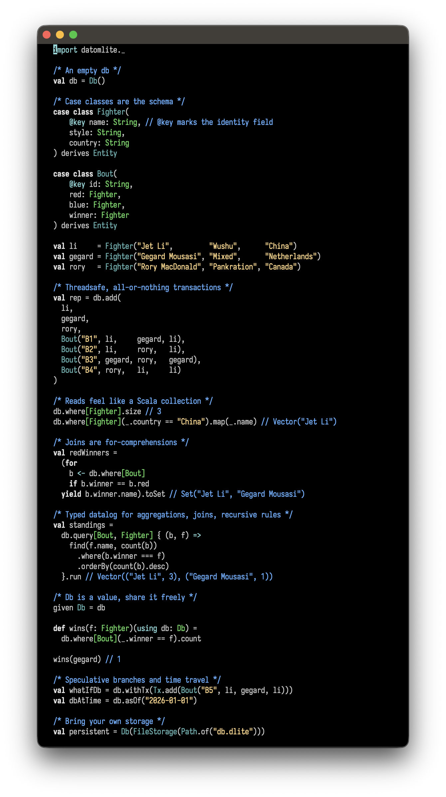
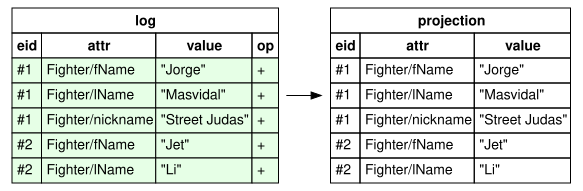
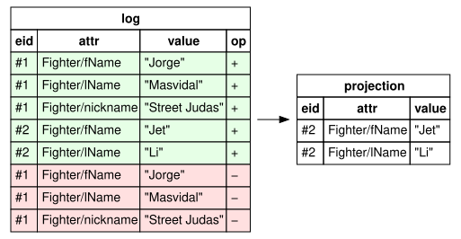
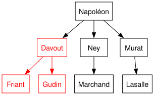
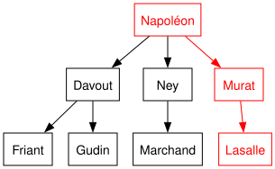
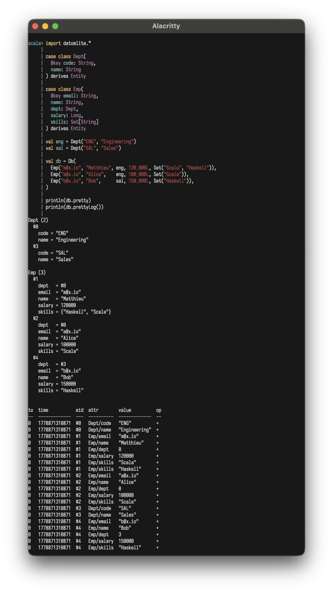

<div align="right">
  <sub><em>part of <a href="https://github.com/mattlianje/d4">c6</a></em></sub>
</div>

<p align="center">
  
</p>

#  datomlite

**Lightweight, immutable database**

**datomlite** is a zero-dep "DB-as-a-value" you can drop into your Scala 3 apps

- Zero deps, pure Scala 3.7+
- Cross-platform (JVM, JS, Native)
- Case classes are "the schema"
- Append-only log: every past state stays queryable
- Typed queries, compile-time checked
- Datalog that feels like plain Scala (no EDN, no DDL)
     - Joins, refs, aggregations, window functions, recursive rules
- The `Db` is a plain immutable value: every write hands back a new one
- A `Conn` when you want one shared, changing db (threads, listeners, live queries)
- Easy time-travel and speculative transactions
- Named-tuple query results
- Implement `Storage` and bring your own backend

```scala
"xyz.matthieucourt" %% "datomlite" % "0.1.0"
```

All you need:
```scala
import datomlite._
```

Try it in your REPL:
```
 scala-cli repl --dep xyz.matthieucourt::datomlite:latest.release
```

## Contents
- [Quick start](#quick-start)
- [Cheatsheet](#cheatsheet)
- [How it works](#how-it-works)
- [FAQ](#faq)
- [Example schema](#example-schema)
- [Modelling your data](#keys-and-uniqueness)
  - [Keys and uniqueness](#keys-and-uniqueness)
  - [Refs and cardinality](#refs-and-cardinality)
  - [Optional fields](#optional-fields)
  - [Value types and codecs](#value-types-and-codecs)
- [Writing](#writing)
  - [Tx blocks](#tx-blocks-batch-multiple-ops)
- [Reading](#reading)
  - [Predicates](#predicates-as-index-probes)
  - [Pull](#pull-to-shape-query-results)
    - [Reverse refs](#reverse-refs)
  - [Queries](#queries)
    - [For-comprehension joins](#for-comprehension-joins)
    - [Typed queries](#typed-queries)
    - [Named-tuple rows](#named-tuple-rows)
    - [Aggregations](#aggregations)
    - [Sort and paging](#sort-and-paging)
  - [Negation](#negation-as-anti-join)
  - [Existential subgoals](#existential-subgoals-semi-joins)
  - [Window functions](#window-functions)
  - [Rules](#rules)
    - [Self-ref closure (`Rule.reaches`)](#self-ref-closure-rulereaches)
    - [Multi-body rules (`Rule[A, B]`)](#multi-body-rules-rulea-b)
    - [Recursive rules (`Rule.recursive`)](#recursive-rules-rulerecursive)
- [Time travel](#time-travel-through-past-states)
  - [History](#history-of-every-entity)
  - [Diff](#diff-two-databases)
- [Conn: a db that changes](#conn-a-db-that-changes)
  - [Listen](#listen-for-db-changes)
  - [Watch](#watch-a-query)
  - [Persistence](#persistence-and-custom-backends)
  - [Sharing the db](#sharing-the-db-across-threads)
- [Debug](#debug-pretty-print-state-and-log)
- [Build / Contribute](#build--contribute)

## Quick start

```scala
import datomlite._

/* Just derive `Entity` on your case classes */
case class Person(@key email: String, name: String) derives Entity

/* A db is a value. Seed it in one tx */
val db = Db(Person("m@x.io", "Matt"), Person("a@x.io", "Alice"))

/* Your db feels like a collection */
db.where[Person].run
db.where[Person].size
db.where[Person](_.email == "m@x.io").one
db.where[Person].filter(_.name.startsWith("M")).take(5).toList
for p <- db.where[Person] do println(p.name)

/* Writes hand back a new db, the old one is untouched */
val db2 = db.upsert(Person("m@x.io", "Matthieu"))
db.where[Person](_.email == "m@x.io").one    // still Matt
db2.where[Person](_.email == "m@x.io").one   // Matthieu

/* Typed Datalog: joins, projections, aggs */
db2.query[Person] { p =>
  find(p.name) where (p.email === "m@x.io")
}.run

/* One shared db that changes? Hold it in a Conn */
val conn = Conn(db2)
conn.retractWhere[Person](_.email == "m@x.io")
conn.db.where[Person].run
```

## Cheatsheet
```
db.where[A](pred)                  rows of A, like a collection
db.query[A, B] { ... }             joins, projections, aggregations, rules
.pull(f)                           nested output, walks refs
db.add / upsert / retractWhere     writes, each hands back a new db
db.tx { b => ... }                 several writes in one tx
db.asOf / history / diff           past states
Conn(db)                           one shared db: listen, watch, storage
db.pretty                          print the live state
```

## How it works
Essentially, datomlite is a bunch of macro based niceties on top of an append-only log of `(eid, attr, value)` triples plus in-memory indices over the live
projection. Your case classes are shredded into triples on write and reassembled on read,
so queries feel like working with your original typed objects.

The indices are **EAVT** for live entity reads, **AVET** for value lookups, and a **class index** to enumerate entities of a Scala type. All are derived from the append-only log and updated in lockstep with each commit.

Suppose we add two pugilists to our database, "Jet Li" and "Masvidal". Adding them appends datoms and the live projection picks them up:

```scala
import datomlite._

case class Fighter(
  fName: String,
  lName: String,
  nickname: Option[String]
) derives Entity

val db = Db(
  Fighter("Jorge", "Masvidal", Some("Street Judas")),
  Fighter("Jet",   "Li",       None),
)
```

<p align="center">
  
</p>

Unsurprisingly, we want to remove Masvidal:
```scala
val db2 = db.retractWhere[Fighter](_.lName == "Masvidal")
db2.where[Fighter].run
// Vector(Fighter("Jet", "Li", None))
```
The new db's live projection drops Masvi, but its log still has every datom (and `db` still has him).

<p align="center">
  
</p>

## FAQ

**Why datomlite?**<br>
First, for good-spirited fun and happy hacking. Second, I have long wanted a datastore "as-a-value" I can drop into my processes and throw my case classes
at, without first carving EDN, registering attributes, or learning a finicky ersatz Datalog DSL.

**Does it support all of Datalog?**<br>
No. Recursion goes through named rules, negation is top-level conjunctions only, and there is no built-in unification beyond the DSL.

**Differences from Datomic / Datascript?**<br>
- Case classes are "the schema". There is no `:db/ident`, no attribute registration or otherwise separate cardinality/uniqueness facts.
- Queries are typed Scala, not vectors of triples. Field access is compile-checked by the datomlite macros.
- Single-process. Writes to a `Conn` are serialized. No peer/transactor, no client API

**`Db` or `Conn`?**<br>
A `Db` is an immutable value: `db.add(...)` returns a new `Db` and leaves `db` as it was. That is all you need for most in-process use, tests,
what-ifs and time travel. A `Conn` holds the current `Db` and swaps in a new one on each commit. Reach for it when several threads share one
changing db, when you want `listen` / `watch`, or when commits should go to a `Storage`.

**Transaction guarantees?**<br>
- **Atomicity.** All asserts and retracts in a tx land together or none do. A `UniqueViolation` or any thrown exception inside a tx block aborts the whole thing with no partial state.
- **Values.** A `Db` never changes, so reads on it never lock, never block, and always see one consistent state.
- **Serialized commits.** Any number of threads can write to a `Conn`. Commits run one at a time, in order, under a short write lock.
- **Atomic read-modify-write.** Writes that read first (predicate writes, tx blocks, tx fns) do that read inside the commit. So a concurrent `conn.upsertWhere(_.name == "hits")(c => c.copy(n = c.n + 1))` never loses an increment.
- **Write-ahead append.** `Storage.append` runs before a commit becomes visible on the `Conn`. If it throws, the tx aborts: no state change and no listener fires.

**What is the inspiration?**<br>
Although **datomlite** borrows ideas from [Datomic](https://www.datomic.com/), [Datascript](https://github.com/tonsky/datascript), [Mentat](https://github.com/mozilla/mentat) and [XTDB](https://xtdb.com/) and is in the general orbit of Datalog flavoured triple stores, it puts particular (and to my knowledge novel) emphasis on type-safety and feeling 100% embedded into the host language. 

**datomlite** is "DB-as-a-value": the `Db` is immutable and the one mutable thing, the `Conn`, is opt-in.

## Example schema
We'll use these vanilla domain entities throughout for example purposes...

```scala
case class Department(@key code: String, name: String) derives Entity
case class Skill(@key name: String) derives Entity
case class Order(buyer: String, item: String, price: Long) derives Entity

case class Employee(
  @key email: String,
  name: String,
  dept: Department,
  salary: Long,
  skills: Set[Skill] = Set.empty,
  nickname: Option[String] = None
) derives Entity
```

...and this db. Unless an example builds its own, `db` is this one:

```scala
val eng = Department("ENG", "Engineering")
val ops = Department("OPS", "Operations")
val sc  = Skill("Scala")
val hs  = Skill("Haskell")

val db = Db(
  Employee("m@x.io", "Matt",  eng, 120_000L, Set(sc, hs)),
  Employee("a@x.io", "Alice", eng, 110_000L, Set(sc)),
  Employee("b@x.io", "Bob",   ops, 150_000L),
  Order("m@x.io", "book",  20L),
  Order("m@x.io", "pen",    5L),
  Order("a@x.io", "lamp",  90L),
  Order("b@x.io", "chair", 60L),
)
```

## Keys and uniqueness
Often, we want to enforce uniqueness of data in our datastore. To this end, **datomlite** lets you mark uniqueness keys:
```
@key                   identity field
@unique                must be unique across the entity
db.upsert(values*)     find by key, retract prior, re-assert under same eid
.key(f)                chained, computed or composite key
.unique(f)             chained, additional unique field
.named("...")          chained, override the attribute prefix
```

Duplicate `@key` or `@unique` raises a `UniqueViolation` and aborts the tx.

```scala
case class User(
  @key email: String,
  @unique handle: String,
  name: String
) derives Entity

val db = Db(User("a@x.io", "shared", "Alice"))
db.add(User("b@x.io", "shared", "Bob"))
// UniqueViolation: 'shared' is taken
```

> [!NOTE]  
> Write your own `Entity.derived` given instances like below to create custom and/or composite
> uniqueness keys
> 
```scala
case class Friend(a: Person, b: Person)
given Entity[Friend] = Entity.derived[Friend].key { f =>
  val Seq(x, y) = Seq(f.a.email, f.b.email).sorted
  (x, y)
}
```

Same simple name across packages collides on the prefix, override with `.named`:
```scala
given Entity[a.Person] = Entity.derived[a.Person].named("a.Person").key(_.email)
given Entity[b.Person] = Entity.derived[b.Person].named("b.Person").key(_.email)
```

## Refs and cardinality
Currently in datomlite, cardinality is a property of the Scala type, not a separate declaration (which might be a bit controversial)

```
T          one datom per row
Option[T]  one datom on Some, nothing on None
Set[T]     one datom per element
R          one datom holding the target's eid (R needs an Entity and a @key)
Option[R]  one target eid on Some, nothing on None
Set[R]     one datom per target eid
```

`===` joins across refs, card-one or card-many.

```scala
db.query[Employee, Department, Skill] { (e, d, s) =>
  find(e.email, s.name) where (
    e.dept === d &&
      d.name === "Engineering" &&
      e.skills === s
  )
}.run // Vector(("m@x.io","Scala"), ("m@x.io","Haskell"), ("a@x.io","Scala"))
```

## Optional fields
For **datomlite** entities `Option[T]` writes a datom only on `Some`. `None` is absence, not a stored null.

```scala
val eng = Department("ENG", "Engineering")

val db = Db(
  Employee("m@x.io", "Matthieu", eng, 120_000L, nickname = Some("Matt")),
  Employee("a@x.io", "Alice",    eng, 110_000L),
)

db.where[Employee](_.nickname.contains("Matt")).run.map(_.email)
// Vector("m@x.io")

db.where[Employee](_.nickname == None).run.map(_.email)
// Vector("a@x.io")
```

In a typed query, `find(e.nickname)` projects the inner type, emits a row only when present.

```scala
db.query[Employee] { e =>
  find(e.email, e.nickname)
}.run
// Vector(("m@x.io", "Matt"))
```

An `Option` of an entity is an optional ref. `.contains` probes by the target, `===` joins through it, and pull gives back an `Option[Pull[R]]`.

```scala
case class Mentor(
  @key email: String,
  name: String,
  mentor: Option[Mentor] = None
) derives Entity

val ann = Mentor("ann@x.io", "Ann")
val db = Db(Mentor("bo@x.io", "Bo", Some(ann)))

db.where[Mentor](_.mentor.contains(ann)).run.map(_.name) // Vector("Bo")
db.where[Mentor](_.mentor.isEmpty).run.map(_.name)       // Vector("Ann")
```

## Value types and codecs
Datoms only store a few plain forms: strings, numbers, booleans and vectors of those.
Any other field type goes through a `Codec[T]` that maps it onto one of them. The usual suspects (UUIDs, dates, collections,
options, tuples...) already have one, and your own case classes and enums get one with `derives Codec`.

```scala
enum Tier derives Codec:
  case Free, Pro

case class Address(street: String, city: String) derives Codec

case class Money(cents: Long)
given Codec[Money] = Codec.of[Money, Long](_.cents, Money(_))

case class Account(
  @key id: UUID,
  tier: Tier,
  home: Address,
  fee: Money,
  limits: Map[String, Int]
) derives Entity
```

```
Tier.Pro                   "Pro"
Address("1 Main", "Paris") Vector("street", "1 Main", "city", "Paris")
Money(250)                 250L
Map("a" -> 1)              Vector(Vector("a", 1))   /* entries sorted */
```

Predicates, typed queries and pull all speak `T`. Literals get encoded going in, projections get decoded coming out.

```scala
db.where[Account](_.tier == Tier.Pro).run   /* AVET probe on "Pro" */
db.query[Account](a => find(a.home) where (a.fee === Money(250))).run
// Vector(Address("1 Main", "Paris"))
```

> [!NOTE]
> Comparisons, sorting and min / max run on the stored form. That is numeric for numbers, lexicographic for strings, and
> element by element for `Vector`s. So an enum sorts by case name, not by ordinal.

### Dates and times
`Time` is a UTC instant (epoch millis, stored as a `Long`) and `Date` a calendar day (days since 1970, stored as an `Int`).
Both sort right and range-probe the index like any number.

```scala
case class Task(@key id: String, due: Date, doneAt: Option[Time]) derives Entity

val d = Date.of(2026, 10, 13)       // or Date.parse("2026-10-13"), Date.today()
d.plusDays(7).iso                   // "2026-10-20"
Date.at(Time.now())                 // the UTC day of an instant

db.where[Task](_.due < Date.today()).run          /* index slice, not a scan */
```

They're plain numbers at runtime so print them with `.iso`. On the JVM `java.time` is one line away:

```scala
given Codec[LocalDate] =
  Codec.of[LocalDate, Long](_.toEpochDay, LocalDate.ofEpochDay)

given Codec[Instant] =
  Codec.of[Instant, Long](_.toEpochMilli, Instant.ofEpochMilli)
```

## Writing
Writes are all-or-nothing and return the new `Db` (on a `Conn`, they commit and return a `TxReport`).

```
db.add(values*)              assert one or more rows in one tx
db.retract(values*)          retract by full equality, misses are silent
db.upsert(values*)           assert, replacing whatever holds the same key
db.retractWhere[A](pred)     find every match and retract in one tx
db.upsertWhere[A](pred)(f)   find every match, apply f and upsert in one tx
db.tx { b => ... }           several ops in one tx
db.transact(tx)              apply a Tx value, get a TxReport back
```

```scala
/* Adding */
val db2 = db.add(
  Employee("c@x.io", "Carol", eng, 95_000L),
  Order("c@x.io", "desk", 200L),
)

/* Read-modify-write by predicate */
val raised = db.upsertWhere[Employee](_.email == "m@x.io") { e =>
  e.copy(salary = e.salary + 5_000L)
}

/* Retract */
val fewer = db2
  .retractWhere[Employee](_.email == "c@x.io")
  .retractWhere[Order](_.buyer == "c@x.io")
```

`db.transact(tx)` returns a `TxReport` with the `tx` id and wall-clock `time` (both feed `asOf`, see [Time travel](#time-travel-through-past-states)) and the
`dbBefore` / `dbAfter` of the write.

## Tx blocks: batch multiple ops
You'll often want to batch transactions that are to run sequentially, and **datomlite** supports this
```
db.tx { b => ... }            mixed add/retract/upsert in one tx
b.add / b.retract / b.upsert  inside the block
b.retractWhere[A](pred)       finds matches, appends a retract
b.upsertWhere[A](pred)(f)     reads matches, applies f, appends an upsert
db.retractWhere / db.upsertWhere(pred)(f)   one-shot tx versions
Tx.batch(steps*)              hold steps as a value
Tx.fn(db => tx)               a step computed from the state-so-far
Tx.block / Tx.retractWhere / Tx.upsertWhere   the same, as Tx values
db.transact(tx)               apply a Tx value
```

Steps run in order against the state-so-far, share one tx id, and commit all-or-nothing. The block runs *inside* the commit, so its reads and its writes are
one atomic step. On a `Conn` no other writer can slip in between. Read through `b.db` to see the state-so-far, including earlier steps in the block.

```scala
val raised = db.tx { b =>
  val m = b.db.where[Employee](_.email == "m@x.io").one.get
  b.upsert(m.copy(salary = m.salary + 5_000L))
}
```

> [!NOTE]
> On a `Conn` the block runs while other writers wait, so keep it short and pure. Calling `conn.add` / `conn.transact` from inside the block throws
> `IllegalStateException`. Use `b` instead.

```scala
val db2 = db.tx { b =>
  b.upsertWhere[Employee](_.email == "m@x.io")(_.copy(name = "Matthieu"))
  b.add(Order("m@x.io", "book", 20L))
}
```

`retractWhere` / `upsertWhere` inside the block:
```scala
val db3 = db.tx { b =>
  b.retractWhere[Order](_.buyer == "ghost@x.io")
  b.upsertWhere[Employee](_.email == "m@x.io")(_.copy(salary = 130_000L))
}
```

A `Tx` is a value too, so you can build one now and apply it later, to any db or conn:
```scala
val tx = Tx.batch(
  Tx.add(Order("m@x.io", "book", 20L)),
  Tx.add(Order("m@x.io", "pen",   5L)),
)
val rep = db.transact(tx)
```

`Tx.fn` is the value-level form of a tx block. It computes its steps from the state-so-far when the tx commits, not when you build it:
```scala
case class Counter(@key name: String, n: Long) derives Entity

val bump = Tx.fn { s =>
  val hits = s.where[Counter](_.name == "hits").run
  Tx.upsert(hits.map(c => c.copy(n = c.n + 1))*)
}

val counted = db.transact(Tx.batch(Tx.add(Counter("hits", 0)), bump)).dbAfter
counted.where[Counter].one   // Some(Counter("hits", 1))
```

`transact` hands back a `TxReport` carrying
```
tx, time, adds, retracts, addedEids, datoms, dbBefore, dbAfter
```
`datoms` holds exactly what the commit appended to the log. `dbAfter` is the db it made.

## Reading
`Query[A]` is the lazy `Iterable[A]` that `db.where[A]` returns. You materialize it with `.run` (`toVector`) or `.one` (`headOption`).

```
db.where[A]                  Query[A] over all rows of A
db.where[A](pred)            Query[A] filtered, probes the index where it can
db.exists[A](pred)           Boolean, short-circuits
db.count[A](pred)            Long, no row materialization
.run / .one                  materialize to Vector / Option
```

```scala
/* Lookups */
db.where[Employee].run                            // Vector[Employee]
db.where[Employee](_.email == "m@x.io").one       // Option[Employee]
db.where[Employee](_.name.startsWith("M")).run    // Vector[Employee]
db.where[Employee](_.salary >= 120_000L).run      // Vector[Employee]

/* Quick checks */
db.exists[Employee](_.email == "m@x.io")        // true
db.count[Employee](_.name.startsWith("M"))      // 1
db.count[Employee]                              // 3

/* Still feels like a collection */
db.where[Employee].toList
db.where[Employee].size
db.where[Employee].head
for e <- db.where[Employee] do println(e.name)
```

## Predicates as index probes
You will have noticed **datomlite** operations with predicates feel like operations on plain collections.

Under the hood, when you use predicates, **datomlite**'s macros lift equality, comparisons and prefixes to index-probed queries (so you aren't scanning all your triples)

```scala
/* index, range and prefix probes */
db.where[Employee](_.email == "m@x.io").run
db.where[Employee](_.salary >= 120_000L).run
db.where[Employee](_.name.startsWith("M")).run

/* a range bounded on both sides */
db.where[Employee](e => e.salary > 100_000L && e.salary <= 150_000L).run

/* probe on the prefix, then filter */
db.where[Employee](e => e.name.startsWith("M") && e.name.length > 4).run

/* a scan */
db.where[Employee](_.name.matches("M.*")).run
```

The value index is sorted, so comparisons (literal on either side) and `startsWith` read just the matching slice. That works on numeric and
string fields. In an `&&`, an equality leaf wins. Failing that, the field with the tightest bounds is probed. The rest of the
predicate filters the slice, so any predicate stays correct and only the cost changes. `||`, regex and arbitrary code fall back to a scan. The same
goes for every other method that takes a predicate, and for comparisons in [typed queries](#typed-queries).

Notably (and powerfully), Ref fields are walked inline, even when nested:
```scala
db.where[Employee](_.email == "m@x.io").one.get.dept.name
db.where[Employee](_.dept.name == "Engineering").run // <-- two hop index probe
db.where[Employee](_.dept == Department("ENG", "Engineering")).run
```

Card-many value fields support `.contains` as an index probe:
```scala
case class Tagged(
  @key name: String,
  tags: Set[String]
) derives Entity

val tdb = Db(
  Tagged("matt", Set("fp", "scala")),
  Tagged("ali",  Set("ml")),
)

tdb.where[Tagged](_.tags.contains("fp")).run.map(_.name) // Vector("matt")
```

## Pull to shape query results
Pull is for *shaping* results. The closure picks the fields you want and walks refs to pull sub-shapes, all against a single snapshot. 

This is especially handy when you want a nested output without writing a join, or to skip materializing heavy entities just to read a few fields.

```
.pull(f) / .pullOne(f)    project rows through Pull[A]
db.byEid[A](eid)          reconstruct an entity from a raw eid
db.pullByEid[A](eid)(f)   pull by raw eid
p.field                   read a single attribute
p.refField(sub)           nested pull through a card-1 ref
p.value                   reconstruct the whole entity
p.reverse[E](_.field)     walk a ref backwards, MultiPull[E]
```

```scala
db.where[Employee](_.email == "m@x.io").pullOne(_.dept(_.name))
// Some("Engineering")

db.where[Employee](_.dept.name == "Engineering").pull(e => (e.email, e.name))
// Vector(("m@x.io", "Matt"), ("a@x.io", "Alice"))
```

By eid (from `TxReport.addedEids` or the log):

```scala
val rep = db.transact(Tx.add(Employee("d@x.io", "Dan", eng, 90_000L)))
val eid = rep.addedEids.head
val db2 = rep.dbAfter

db2.byEid[Employee](eid)
// Some(Employee(...))

db2.pullByEid[Employee](eid)(e => (e.name, e.dept(_.name)))
// Some(("Dan", "Engineering"))
```

Both return `None` for missing or wrong-type eids.

### Reverse refs
Walks a ref backwards from `p` to every `E` pointing at `p`. Card-one or card-many.

```scala
db.where[Department](_.code == "ENG")
  .pullOne(d => d.reverse[Employee](_.dept).map(_.name))
// Some(Vector("Matt", "Alice"))
```

Nests inside larger pull trees:

```scala
db.where[Department](_.code == "ENG").pullOne { d =>
  (d.name, d.reverse[Employee](_.dept).map(e => (e.name, e.skills.map(_.name))))
}
// Some((
//   "Engineering",
//   Vector(
//     ("Matt",  Vector("Scala", "Haskell")),
//     ("Alice", Vector("Scala")),
//   ),
// ))
```

Without `reverse`, a flat query plus regrouping pass is needed, and anyone with empty skills drops to the inner join:

```scala
val triples = db.query[Department, Employee, Skill] { (d, e, s) =>
  find(e.name, s.name) where (
    d.code === "ENG" && e.dept === d && e.skills === s
  )
}.run
// Vector(("Matt", "Scala"), ("Matt", "Haskell"), ("Alice", "Scala"))
```

## Queries
For querying, you have two surfaces: 
- (1/2) for-comprehensions over `where` for plain stitching on a shared scalar
- (2/2) `db.query[...]` for projections, joins, aggregations, windows, and rules with compile-time field checks.

### For-comprehension joins
Stitch `where[A]` results together with normal Scala for-comprehensions, no DSL.

```scala
(for
  e <- db.where[Employee]
  o <- db.where[Order](_.buyer == e.email)
yield (e.name, o.item)).run
// Vector(("Matt", "book"), ("Matt", "pen"),
//        ("Alice", "lamp"), ("Bob", "chair"))
```

> [!NOTE]
> Every join here is a nested loop. Reach for `db.query[...]` once you need projections, multi-entity joins, or indexed equality.

### Typed queries
The full surface: projections, multi-entity joins, aggregations, windows, rules. Each type parameter binds a row, `find(...)` projects, `where(...)` constrains. Combine with `&&` / `||`, compare with `===` / `!==` and the usual ordering operators. Field access is compile-checked, `where` is optional.

```scala
db.query[Employee] { e =>
  find(e.name) where (e.email === "m@x.io")
}.run
// Vector("Matt")

db.query[Employee] { e =>
  find(e.name)
}.run
// Vector("Matt", "Alice", "Bob")
```

`||` distributes over `&&`. Disjuncts run as separate passes, call `.distinct` for set semantics.

```scala
db.query[Employee] { e =>
  find(e.name) where (e.email === "m@x.io" || e.email === "b@x.io")
}.run
// Vector("Matt", "Bob")
```

Joins on a ref use `===`, on a shared scalar use field equality:

```scala
db.query[Employee, Department] { (e, d) =>
  find(e.email, d.name) where (
    e.dept === d &&
      d.name === "Engineering"
  )
}.run
// Vector(("m@x.io","Engineering"), ("a@x.io","Engineering"))

db.query[Employee, Order] { (e, o) =>
  find(e.name, o.item) where (
    e.email === o.buyer && o.price > 50L
  )
}.run
// Vector(("Alice","lamp"), ("Bob","chair"))
```

Typos list available fields at compile time which is nice:
```scala
db.query[Employee] { e => find(e.emial) where (e.email === "x") }
does not compile: `emial` is not a field of Employee.
Available: email, name, dept, salary, skills, nickname
```

Reusable constraints are functions returning `Constraint`:
```scala
def engineers(d: Row[Department]): Constraint = d.name === "Engineering"
def expensive(e: Row[Employee], min: Long): Constraint = e.salary > min

db.query[Employee, Department] { (e, d) =>
  find(e.email) where (
    engineers(d) && expensive(e, 100_000L) && e.dept === d
  )
}.run
```

### Named-tuple rows
Pass named args to `find(...)` and the row is a `NamedTuple` with those exact labels and types.

```scala
val rows = db.query[Employee, Department] { (e, d) =>
  find(name = e.name, dept = d.name, salary = e.salary)
    .where(e.dept === d)
    .orderBy(e.salary.desc)
}.run
// Vector[NamedTuple[("name","dept","salary"), (String, String, Long)]]

rows.head.name          // "Bob"
rows.map(_.salary).sum  // 380000L
```

```scala
for case (name = n, salary = s) <- rows if s > 100_000L
yield s"$n earns $s"
```

### Aggregations
**datomlite** comes with built-in "sugar" for `groupBy` + fold over the query rows. 

```
count(t) / countDistinct(t)    Long
sum(t) / avg(t)                Numeric[T]
min(t) / max(t)                Ordering[T]
```

```scala
db.query[Employee, Order] { (e, o) =>
  find(e.name, sum(o.price)) where (e.email === o.buyer)
}.run
// Vector(("Matt",25), ("Alice",90), ("Bob",60))
```

For one-entity rollups, stay in Scala:

```
Query[A].groupBy(f)    Map[K, Vector[A]] with .agg extension
Query[A].countBy(f)    Map[K, Long]
```

```scala
db.where[Order].groupBy(_.buyer).agg(_.map(_.price).sum)
// Map("m@x.io" -> 25, "a@x.io" -> 90, "b@x.io" -> 60)

db.where[Order].countBy(_.buyer)
// Map("m@x.io" -> 2, "a@x.io" -> 1, "b@x.io" -> 1)
```

### Sort and paging
Order and slice on the `Query` itself

```
.orderBy(term.asc | term.desc, ...)   typed query, keys must be in find(...)
.orderBy(f) / .orderByDesc(f)         where[A] surface, by selector
.limit(n) / .offset(n)
```

```scala
db.query[Employee] { e =>
  find(e.name, e.salary)
    .where(e.salary > 100_000L)
    .orderBy(e.salary.desc)
    .limit(2)
}.run
// Vector(("Bob",150000), ("Matt",120000))

db.where[Employee].orderBy(_.salary).limit(2).run
db.where[Order].orderByDesc(_.price).offset(10).limit(10).run
```

## Negation as anti-join
With **datomlite** `not(c)` is the "anti-join". 

```scala
/* employees with no orders */
db.query[Employee, Order] { (e, o) =>
  find(e.name) where not(e.email === o.buyer)
}.run
```

`not(...)` only sits in the top-level conjunction. No `||`, no `not(not(...))`. Every variable inside `not` must be scoped by the outer positive part (i.e. Datalog-safe negation).

## Existential subgoals (semi-joins)

When writing queries, you often ask yourself: "does at least one such row exist?", but don't want to bring the matched
row into your output (like in a semi-join).

To this end **datomlite** queries can have `exists[A] { row => ... }` which binds a fresh row scoped to the constraint body, without projecting it.

```scala
/* orders whose buyer exists as a registered Employee */
db.query[Order] { o =>
  find(o.item) where exists[Employee] { e => e.email === o.buyer }
}.run
```

## Window functions
Like with aggregations, datomlite's window functions are just sugar on top of datalog so
you don't have to hand-roll such windowing on Scala vectors.

```scala
db.query[Employee, Department] { (e, d) =>
  find(
    d.name,
    e.name,
    e.salary,
    rank()           over partitionBy(d).orderBy(e.salary.desc),
    sum(e.salary)    over partitionBy(d)
  ).where(e.dept === d)
}.run
```

Available functions:
```
rowNumber()                          Long       1-indexed, needs orderBy
rank()                               Long       ties share rank, then skip
denseRank()                          Long       ties share rank, no gaps
lag(t, n = 1) / lead(t, n = 1)       Option[T]  None past the partition edge
sum/min/max/avg/count(t).over(spec)  as input   broadcast over the partition
```

```scala
db.query[Employee, Department] { (e, d) =>
  find(d.name, e.name, rowNumber() over partitionBy(d).orderBy(e.salary.desc))
    .where(e.dept === d)
    .orderBy(d.name.asc)
}.run.filter(_._3 == 1L) // top earner per dept
```

## Rules
A `Rule[A, B]` is a named, reusable predicate between two rows.

Multiple bodies act as Datalog disjunction (any one holds). Recursive rules (body references `self`) evaluate to a fixed point.

```
Rule.reaches[A](_.field)              transitive closure of one self-ref field
Rule[A, B](bodies*)                   multi-body Datalog without recursion
Rule.recursive[A, B] { self => ... }  recursive Datalog, naive fixed-point
rule(src, dst)                        call inside any where(...)
```

### Self-ref closure (`Rule.reaches`)
"All entities reachable from `src` along one ref field". It walks the AVET edge directly, without a fixed-point.

```scala
case class Node(
  @key id: String,
  children: Set[Node]
) derives Entity

val d = Node("d", Set.empty)
val c = Node("c", Set(d))
val a = Node("a", Set(c))
val b = Node("b", Set.empty)
val db = Db(Node("root", Set(a, b)))

val reachable: Rule[Node, Node] = Rule.reaches[Node](_.children)

db.query[Node, Node] { (s, t) =>
  find(t.id) where (s.id === "root" && reachable(s, t))
}.run.toSet
// Set("a", "b", "c", "d")
```

### Multi-body rules (`Rule[A, B]`)
Each body is a constraint over the head row params. Multiple bodies act as Datalog disjunction: a pair satisfies the rule if any one body holds.

```scala
case class User(@key email: String, role: String) derives Entity
case class Doc(@key slug: String, owner: String, public: Boolean) derives Entity

val canRead: Rule[User, Doc] = Rule[User, Doc](
  (u, d) => d.owner === u.email,
  (u, d) => d.public === true,
  (u, d) => u.role === "admin"
)

db.query[User, Doc] { (u, d) =>
  find(u.email, d.slug) where canRead(u, d)
}.run
```

### Recursive rules (`Rule.recursive`)
The closure receives the rule itself, so a body can call back into it for the recursive case. Evaluation is fixed-point and always terminates over the finite fact domain.

Let's imagine we have a hierarchy of officers...
<p align="center">
  
</p>

```scala
case class Off(
  @key name: String,
  boss: Option[String]
) derives Entity

val db = Db(
  Off("Napoléon", None),
  Off("Davout",   Some("Napoléon")),
  Off("Ney",      Some("Napoléon")),
  Off("Murat",    Some("Napoléon")),
  Off("Friant",   Some("Davout")),
  Off("Gudin",    Some("Davout")),
  Off("Lasalle",  Some("Murat")),
  Off("Marchand", Some("Ney")),
)

val ancestor: Rule[Off, Off] =
  Rule.recursive[Off, Off] { self =>
    Seq(
      (anc, desc) => desc.boss === anc.name,
      (anc, desc) => exists[Off] { mid =>
        desc.boss === mid.name && self(anc, mid)
      }
    )
  }
```

**Subordinates of "Davout":**
<p align="center">
  
</p>

```scala
db.query[Off, Off] { (anc, desc) =>
  find(desc.name) where (anc.name === "Davout" && ancestor(anc, desc))
}.run.toSet
// Set("Friant", "Gudin")
```

**"Lasalle"'s reporting line:**
<p align="center">
  
</p>

```scala
db.query[Off, Off] { (anc, desc) =>
  find(anc.name) where (desc.name === "Lasalle" && ancestor(anc, desc))
}.run.toSet
// Set("Murat", "Napoléon")
```

In SQL: recursive CTE.

```sql
WITH RECURSIVE ancestor(anc, desc) AS (
  SELECT boss, name FROM off WHERE boss IS NOT NULL
  UNION
  SELECT a.anc, o.name
  FROM ancestor a JOIN off o ON o.boss = a.desc
)
SELECT desc FROM ancestor WHERE anc = 'Napoléon';
```

#### Directed graph (Roads)

<p align="center">
  
</p>

```scala
case class Place(@key code: String) derives Entity

case class Road(
  from: Place,
  to: Place
)
given Entity[Road] = Entity.derived[Road].key(r => (r.from.code, r.to.code))

def road(a: String, b: String) = Road(Place(a), Place(b))

val db = Db(
  road("PAR", "LYO"),
  road("LYO", "MAR"),
  road("MAR", "PAR"),   // cycle
  road("LYO", "NCE"),
  road("PAR", "BOR"),
)

val reachable: Rule[Place, Place] =
  Rule.recursive[Place, Place] { self =>
    Seq(
      (s, t) => exists[Road] { r => r.from === s && r.to === t },
      (s, t) => exists[Place] { mid =>
        exists[Road] { r => r.from === s && r.to === mid } && self(mid, t)
      }
    )
  }

/* Everywhere reachable from Paris. The cycle means PAR reaches itself */
db.query[Place, Place] { (s, t) =>
  find(t.code) where (s.code === "PAR" && reachable(s, t))
}.run.toSet
// Set("LYO", "MAR", "PAR", "NCE", "BOR")
```

#### Undirected graph (Friends)

<p align="center">
  
</p>

```scala
case class Person(@key handle: String) derives Entity

case class Friend(
  a: Person,
  b: Person
)
given Entity[Friend] = Entity.derived[Friend].key { f =>
  val Seq(x, y) = Seq(f.a.handle, f.b.handle).sorted
  (x, y)
}

def edge(x: String, y: String) = Friend(Person(x), Person(y))

val db = Db(
  edge("alice", "bob"),
  edge("alice", "carol"),
  edge("bob",   "dave"),
  edge("carol", "dave"),
  edge("dave",  "erin"),
  edge("frank", "grace"),
)

/* `knows` is symmetric, two bodies one per orientation */
val knows: Rule[Person, Person] =
  Rule[Person, Person](
    (x, y) => exists[Friend] { f => f.a === x && f.b === y },
    (x, y) => exists[Friend] { f => f.a === y && f.b === x }
  )

/* `connected` is the closure over `knows`, like `ancestor` */
val connected: Rule[Person, Person] =
  Rule.recursive[Person, Person] { self =>
    Seq(
      (x, y) => knows(x, y),
      (x, y) => exists[Person] { mid => knows(x, mid) && self(mid, y) }
    )
  }

/* Alice's cluster */
db.query[Person, Person] { (x, y) =>
  find(y.handle) where (x.handle === "alice" && connected(x, y))
}.run.toSet
// Set("bob", "carol", "dave", "erin")

/* Frank is in a separate component */
db.query[Person, Person] { (x, y) =>
  find(y.handle) where (
    x.handle === "alice" && y.handle === "frank" && connected(x, y)
  )
}.run
// Vector()
```

## Time travel through past states
Every `Db` keeps its whole log, so you can read any past state of it. And since writes return a new `Db`, a speculative branch is just a write you
don't keep.

```
db.asOf(tx)               rewind to a tx id
db.asOf(time)             rewind to a Time
db.asOf("2026-01-15")     takes any ISO-8601
db.add(...)               a branch, db itself is untouched
```

```scala
val rep1 = db.transact(Tx.add(Employee("d@x.io", "Dan", eng, 90_000L)))
val db1  = rep1.dbAfter
val rep2 = db1.transact(Tx.add(Employee("f@x.io", "Fay", eng, 95_000L)))
val now = rep2.dbAfter

now.where[Employee].count                    // 5
now.asOf(rep1.tx).where[Employee].count      // 4, before Fay
now.asOf(rep2.time).where[Employee].count    // 5, by wall-clock
```

ISO-8601 strings accept `Z` or `±HH:MM`, default UTC:

```scala
now.asOf("2026-01-15").where[Employee].count             // by date
now.asOf("2026-01-15T10:30:00Z").where[Employee].count   // by instant
```

What-if:
```scala
val whatIf = now.add(Employee("e@x.io", "Eve", eng, 100_000L))

whatIf.where[Employee].count   // 6, includes Eve
now.where[Employee].count      // 5, untouched
```

On a `Conn`, `conn.db` is the snapshot: hold on to it and later commits won't touch it.

## History of every entity
You can call `.log` on any db to get the full history of triples... or `.history`/`.historyOf` to get the history of
specific entities.

```
db.log             every datom in tx order
db.historyOf(a)    trail for the entity currently matching a
db.history(eid)    trail for an eid, survives retraction
```

Each datom carries its tx, its time and whether it was an assert or a retract. Nothing is overwritten.

```scala
val daniel = Employee("d@x.io", "Daniel", eng, 95_000L, nickname = Some("Dan"))

val rep1 = db.transact(Tx.add(Employee("d@x.io", "Dan", eng, 90_000L)))
val db2 = rep1.dbAfter
  .upsert(daniel)
  .retractWhere[Employee](_.email == "d@x.io")

db2.log
// every Datom across every tx, with (eid, attr, value, tx, time, op)

db2.historyOf(daniel)
// empty, no live entity matches

db2.history(rep1.addedEids.head)
// full assert/retract trail for that eid
```

## Diff two databases
When your database is a value, you can do fun things like diff it against another database, or the same database
with some speculative transactions that have been applied to it.

`a.diff(b)` returns `DbDiff(added, retracted)` over the live `(eid, attr, value)` triples. Works for any two dbs from the same lineage: before and
after a write, two branches, or `asOf` views (see [Time travel](#time-travel-through-past-states)).

```scala
val after = db.upsertWhere[Employee](_.email == "m@x.io") {
  _.copy(name = "Matthieu")
}

val d = db.diff(after)
d.added.map(_.v)        // Vector("Matthieu")
d.retracted.map(_.v)    // Vector("Matt")
```

Or for a what-if:

```scala
val withEve = db.add(Employee("e@x.io", "Eve", eng, 100_000L))
db.diff(withEve).added   // datoms Eve would add
```

A `TxReport` carries both sides, so `rep.dbBefore.diff(rep.dbAfter)` is what one commit changed.

## Conn: a db that changes
A `Db` value never changes. When you want one db that a whole app shares and writes to, hold it in a `Conn`. It has the same write verbs as `Db`,
but they commit in place and return the `TxReport`. `conn.db` is the current value.

```
Conn()                       in-memory, empty
Conn(db)                     in-memory, starting from db
Conn(storage)                replays storage, appends each commit to it
conn.db                      the db right now, a plain value
conn.add / upsert / tx ...   commit and return a TxReport
conn.listen(f)               hear every commit
conn.watch(q)(f)             live query
conn.close()                 close the storage
```

```scala
val conn = Conn(db)
conn.add(Order("m@x.io", "book", 20L))

val now = conn.db                 // a value, later commits don't touch it
now.where[Order].count
```

## Listen for db changes
You often want to respond to changes made to your datastore, which is why a `Conn` has `.listen`.

The callback fires after each successful commit with the `TxReport`, so you know exactly what changed. Use it for cache invalidation, outbox pushes, WebSocket fan-out, audit logs, or any side effect that should trail a write.

```scala
val sub = conn.listen { rep =>
  println(s"tx ${rep.tx.value}: +${rep.adds.size} -${rep.retracts.size}")
}
sub.cancel()

/* a Subscription is AutoCloseable, so Using works too */
Using.resource(conn.listen(...)) { _ => ... }
```

- Every commit once, in tx order, even with lots of writers. You only hear commits made after you subscribe.
- If a listener throws the tx and other listeners are fine. The error goes to `ExecutionContext.defaultReporter`.
- A listener can write to the conn. It hears that write once the current callback returns.
- Callbacks run outside the lock but `transact` may wait on them... so keep them quick.

## Watch a query
`listen` tells you *that* something changed. `watch` tells you *what* your query now returns. It runs the query once up front, then again after each commit
that could change the result. `f` fires only when the result actually differs from the previous one.

```scala
def wellPaid(s: Db) = s.where[Employee](_.salary > 100_000L).run.map(_.email)

val sub = conn.watch(wellPaid)(emails => println(emails))
// prints the current emails now, then again whenever that set changes

conn.watch(_.count[Order])(n => println(s"$n orders"))
```

- **Dependency tracking.** The query's reads are recorded per entity class, including ref targets it walks into. So a watch over `Employee` re-runs when an
  `Employee` or its `Department` changes, and skips commits that only touch `Order`s.
- **Materialized results only.** The query must return a value, not a lazy `Query` or selector, because a lazy result would compare by identity. `.run` it,
  or `.count` it. The compiler tells you if you forget.
- Same ordering, isolation and `Subscription` handling as `listen`.

> [!WARNING]
> Read through the db handed to the query (`_.where...` / `s => s.where...`), not `conn.db` or some other db. Those reads aren't tracked, and they can see
> a different state than the one being reported.

## Persistence and custom backends
Storage is optional: a `Db` lives in memory. Hand a `Storage` to a `Conn` and every commit is appended to it. `FileStorage` ships for JVM and
Native. Restart with the same path, the log replays.

```scala
import datomlite.*
import java.nio.file.Path

val eng = Department("ENG", "Engineering")

val conn = Conn(FileStorage(Path.of("db.dlite")))
conn.add(Employee("m@x.io", "Matt", eng, 120_000L))

/* kill the JVM, restart with the same path */
val conn2 = Conn(FileStorage(Path.of("db.dlite")))
conn2.db.where[Employee].one
// Some(Employee("m@x.io", "Matt", ...))

/* or just read it into a value */
val db = Db.load(FileStorage(Path.of("db.dlite")))
```

Bring your own backend in two methods (plus an optional `close`):

```scala
trait Storage:
  def load(): Vector[Datom]                 /* once at boot */
  def append(datoms: Vector[Datom]): Unit   /* each tx, before it's visible */
  def close(): Unit = ()                    /* on conn.close() */
```

`append` is called under the conn's write lock, before the commit is published. If it throws, the tx aborts and nothing changes. Storage order therefore
always matches `conn.db.log`.

> [!WARNING]
> Durability is only as strong as your `append`. `FileStorage` writes but doesn't `fsync`, so an OS crash can lose recent txs. In a datascript-ish way you can implement `Storage` with `fsync` semantics if you need stronger guarantees.

## Sharing the db across threads
`Db` is a plain immutable value, pass it anywhere and read it from any thread.

```scala
def loadAll(db: Db): Vector[Employee] = db.where[Employee].run

given Db = db
def countAll(using db: Db): Long = db.where[Employee].count
```

For one db that many threads write to, share a `Conn`. Writes are serialized, reads of `conn.db` never block, and `upsertWhere` / `tx` blocks are atomic
read-modify-writes (see [Transaction guarantees](#faq)).

```scala
val conn = Conn(Db(Counter("hits", 0)))

/* from any number of threads, no increment is lost */
conn.upsertWhere[Counter](_.name == "hits")(c => c.copy(n = c.n + 1))
```

## Debug: pretty-print state and log
Print the live state or the raw log to stdout.

```
db.pretty                 live state grouped by entity class
db.prettyLog(color)       tab-aligned log: tx | time | eid | attr | value | op
```

<p align="center">
  
</p>

## Build / Contribute
Scala, Mill and a JVM. PRs welcome, please keep it zero-dep.
```
make compile
make test
make repl
make fmt
```
