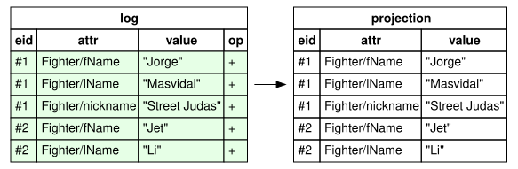
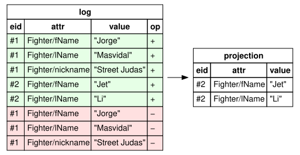
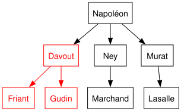
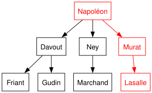

<div align="right">
  <sub><em>part of <a href="https://github.com/mattlianje/d4">c6</a></em></sub>
</div>

#  datomlite

**Lightweight, immutable database**

**datomlite** is zero-dep "DB-as-a-value" you can drop into your Haskell apps to store and retrieve your records.
You can drop **Datomlite.hs** into your project and use it like a header file.

- Pure Haskell, zero-deps
- The `Db` is a plain immutable value
- Records are "the schema"
- Append-only log
     - Every past state stays queryable
- Queries are plain do-blocks, compile-time checked
     - Joins, refs, indexed lookups, negation, and recursive rules as recursive functions
- Easy time travel & speculative transactions
- IO only at the edge

```cabal
-- cabal.project
source-repository-package
  type:     git
  location: https://github.com/mattlianje/datomlite
  subdir:   datomlite-hs

-- your .cabal file
build-depends: datomlite
```

All you need:
```haskell
import Datomlite
```

Try it in your REPL:
```
cd datomlite-hs && cabal repl
```

## Contents
- [Quick start](#quick-start)
- [Cheatsheet](#cheatsheet)
- [How it works](#how-it-works)
- [FAQ](#faq)
- [Example schema](#example-schema)
- Model your data
  - [Mark unique fields with `Identity`](#mark-unique-fields-with-identity)
  - [Look up entities by identity](#look-up-entities-by-identity)
  - [Link entities with refs](#link-entities-with-refs)
  - [Leave fields out with `Maybe`](#leave-fields-out-with-maybe)
  - [Store enums, newtypes and other values](#store-enums-newtypes-and-other-values)
- [Write data](#write-data)
  - [Add data](#add-data)
  - [Update data](#update-data)
  - [Remove data](#remove-data)
  - [Chain dependent steps in a `Tx` block](#chain-dependent-steps-in-a-tx-block)
- [Read data](#read-data)
  - [Get one entity](#get-one-entity)
  - [List, filter and count entities](#list-filter-and-count-entities)
  - [Run queries](#run-queries)
    - [Join in a do-block](#join-in-a-do-block)
    - [Look up rows through the index](#look-up-rows-through-the-index)
    - [Read fields with their real types](#read-fields-with-their-real-types)
    - [Follow refs backwards](#follow-refs-backwards)
    - [Aggregate rows](#aggregate-rows)
    - [Sort and page results](#sort-and-page-results)
  - [Exclude matches with `none`](#exclude-matches-with-none)
  - [Check that a match exists](#check-that-a-match-exists)
  - [Rank and total with window functions](#rank-and-total-with-window-functions)
  - [Reuse logic with rules](#reuse-logic-with-rules)
    - [Write recursive rules](#write-recursive-rules)
    - [Walk graphs with cycles (`closure`)](#walk-graphs-with-cycles-closure)
- [Travel back in time](#travel-back-in-time)
  - [See every change to an entity](#see-every-change-to-an-entity)
  - [Diff two dbs](#diff-two-dbs)
- [Share a changing db with `Conn`](#share-a-changing-db-with-conn)
  - [React to every commit](#react-to-every-commit)
  - [Keep a query result up to date](#keep-a-query-result-up-to-date)
  - [Save and restore a db](#save-and-restore-a-db)
  - [Read and write from many threads](#read-and-write-from-many-threads)
- [Build / Contribute](#build--contribute)

## Quick start

<details>
<summary>Pragmas and imports</summary>

```haskell
{-# LANGUAGE DeriveGeneric #-}
{-# LANGUAGE DeriveAnyClass #-}
{-# LANGUAGE DuplicateRecordFields #-}
{-# LANGUAGE OverloadedStrings #-}
{-# LANGUAGE OverloadedRecordDot #-}
{-# LANGUAGE DataKinds #-}
{-# LANGUAGE TypeApplications #-}
{-# LANGUAGE TypeFamilies #-}
import Control.Monad (guard)
import Data.Text (Text)
import GHC.Generics (Generic)
import Datomlite
```

</details>

```haskell
import Datomlite

-- Your records are the schema. `Identity` names the unique fields
data Person = Person { email :: Text, name :: Text }
  deriving (Show, Generic)

instance Entity Person where
  type Identity Person = '["email"]

-- Start from `emptyDb`. Commit a list of writes and get a new db back
Right db = commit_ emptyDb
  [ Insert (Person "m@x.io" "Matt")
  , Insert (Person "a@x.io" "Alice")
  ]

-- Your db feels like a collection
[ p.name | p <- every @Person db ]          -- ["Matt","Alice"]
length (every @Person db)                   -- 2
(.name) <$> find @Person "a@x.io" db        -- Just "Alice", by identity

-- Upsert by identity
Right db' = commit_ db [Upsert (Person "m@x.io" "Matthieu")]

-- Queries are plain do-blocks
query db' $ do
  p <- match @Person
  guard (p.email == "m@x.io")
  pure p.name
-- ["Matthieu"]

Right db'' = commit_ db' [Delete (ref @Person "m@x.io")]
```

## Cheatsheet
```
every @A db / find @A v db       rows of A, like a collection
query db $ do ...                joins, lookups, negation, rules
commit_ db [Insert r, ...]       writes, each hands back a new db
commit db $ do ...               a Tx block, for steps that need each other
asOf / history / datoms          past states
connect db                       one shared db: transact, listen, watch
history / fromHistory            save and restore
```

## How it works
Under the hood, **datomlite** is an append-only log of (entity, attribute, value)
datoms with a couple of in-memory indices on top. GHC.Generics splits your
records into datoms on write and rebuilds them on read, so you only ever see
your own types.

The indices are EAVT (read an entity) and AVET (look something up by value).
That's why `matchBy` is fast and `match` + `guard` is a scan: `guard` only
filters rows after they're produced. When you're matching a field against a
value, reach for `matchBy`.

Say we add two pugilists, Jet Li and Masvidal:

```haskell
data Fighter = Fighter
  { fName    :: Text
  , lName    :: Text
  , nickname :: Maybe Text
  } deriving (Show, Generic)

instance Entity Fighter where
  type Identity Fighter = '["lName"]

Right db = commit_ emptyDb
  [ Insert (Fighter "Jorge" "Masvidal" (Just "Street Judas"))
  , Insert (Fighter "Jet"   "Li"       Nothing)
  ]
```

<p align="center">
  
</p>

Unsurprisingly, we want to retract Masvidal:
```haskell
Right db' = commit_ db [Delete (ref @Fighter "Masvidal")]
map recordOf (every @Fighter db')
-- [Fighter {fName = "Jet", lName = "Li", nickname = Nothing}]
```
Masvidal is gone from the live state, but not from the log. `history db'` still
has all 8 datoms (5 asserts, 3 retracts), while `datoms db'` only has Jet Li's 2.

<p align="center">
  
</p>

## FAQ

**Is the Db really a value?**<br>
Yes. It's an ordinary immutable Haskell value and `commit` is a pure function.
A snapshot is just the value you're already holding.

**Does it support all of Datalog?**<br>
No, there's no Datalog engine. A query is a do-block in a list-like monad, so
joins are nested loops and recursion is plain Haskell recursion. `closure`
handles graphs with cycles.

**Differences from Datomic / Datascript?**<br>
- Records are "the schema". No `:db/ident`, no attribute registration, no
  separate cardinality or uniqueness facts.
- Queries are typed Haskell, not vectors of triples.
- It's a single process. No peer, no transactor, no client/server.

**Transaction guarantees?**<br>
- **Atomicity.** All the writes in a commit land together, or none do.
- **Purity.** `commit` returns a new db and leaves the old one alone, so there's
  nothing to lock.
- **Linearizable commits.** Writers to a Conn take turns, and each commit sees
  the one before it. A transaction that throws leaves the Conn as it was.
- **Snapshot reads.** A Db never changes. `transact` gives you back the one your
  commit made, and `snapshot` the one the Conn holds right now.

**What if I change a record?**<br>
Old datoms stay as they were and `load` reads them into the new type. If you add,
rename or retype a field, older entities won't fit and you'll get `MissingField`
or `BadValue`. There's no migration story, and if you need one you've probably
outgrown a cheap DB-as-a-value.

**What can be an entity?**<br>
A record with one constructor and named fields (each field name becomes an
attribute). Anything else is a type error that tells you what to change.

## Example schema
The examples below use these plain domain entities...

```haskell
data Department = Department { code :: Text, name :: Text }
  deriving (Show, Generic)
instance Entity Department where
  type Identity Department = '["code"]

data Skill = Skill { name :: Text }
  deriving (Show, Generic)
instance Entity Skill where
  type Identity Skill = '["name"]

data Order = Order { buyer :: Text, item :: Text, price :: Int }
  deriving (Show, Generic, Entity)

data Employee = Employee
  { email    :: Text
  , name     :: Text
  , dept     :: Ref Department
  , salary   :: Int
  , skills   :: Set (Ref Skill)
  , nickname :: Maybe Text
  } deriving (Show, Generic)
instance Entity Employee where
  type Identity Employee = '["email"]
```

...and this db:

```haskell
Right db = commit_ emptyDb
  [ Insert (Department "ENG" "Engineering")
  , Insert (Department "SAL" "Sales")
  , Insert (Skill "Scala")
  , Insert (Skill "Haskell")
  , Insert (Employee "m@x.io" "Matt"  (deptRef "ENG") 120000 (skillRefs ["Scala", "Haskell"]) (Just "Matty"))
  , Insert (Employee "a@x.io" "Alice" (deptRef "ENG") 110000 (skillRefs ["Scala"])            Nothing)
  , Insert (Employee "b@x.io" "Bob"   (deptRef "SAL") 150000 mempty                           Nothing)
  , Insert (Order "m@x.io" "book" 20)
  , Insert (Order "a@x.io" "lamp" 90)
  , Insert (Order "b@x.io" "chair" 60)
  ]
  where
    deptRef   = ref @Department
    skillRefs = Set.fromList . map (ref @Skill)

-- Engineering's Ref, for the examples below
Just eng = refOf <$> find @Department "ENG" db
```

`ref @Department "ENG"` points at a department by its code, which is how the
employees can reference it in the same list ([more on that](#look-up-entities-by-identity)).
Records can also share field names like `name`, thanks to `DuplicateRecordFields`.

The snippets from here on assume these:

<details>
<summary>Pragmas and imports</summary>

```haskell
{-# LANGUAGE DeriveGeneric #-}
{-# LANGUAGE DeriveAnyClass #-}
{-# LANGUAGE DuplicateRecordFields #-}
{-# LANGUAGE OverloadedStrings #-}
{-# LANGUAGE OverloadedRecordDot #-}
{-# LANGUAGE DataKinds #-}
{-# LANGUAGE TypeApplications #-}
{-# LANGUAGE TypeFamilies #-}
import Control.Applicative ((<|>))
import Control.Monad (guard, when)
import Data.Foldable (for_, traverse_)
import Data.List (sortOn, (\\))
import qualified Data.Map.Strict as Map
import Data.Ord (Down (..))
import Data.Set (Set)
import qualified Data.Set as Set
import Data.Text (Text)
import Data.Time (getCurrentTime)
import GHC.Generics (Generic)
import Datomlite
```

</details>

## Mark unique fields with `Identity`
List a record's unique fields in its `Identity`. That's also how `find`, `ref`
and `Upsert` know which entity you mean.
```
type Identity t = '["f", ...]   each field unique on its own (default: none)
Upsert r                        find by identity and write only the difference
ename                           override the attribute prefix
```

The record itself stays plain, `email` is still just Text. A typo in the list
won't compile:
```
datomlite: Identity User names "emial" but User has no such field
```

Each field in the list is unique on its own (like Datomic's
`:db.unique/identity`). A duplicate fails with `UniqueViolation` and nothing
gets written.

```haskell
data User = User
  { email  :: Text
  , handle :: Text
  , name   :: Text
  } deriving (Show, Generic)

instance Entity User where
  type Identity User = '["email", "handle"]

Right udb = commit_ emptyDb [Insert (User "a@x.io" "shared" "Alice")]

commit_ udb [Insert (User "b@x.io" "shared" "Bob")]
-- Left (UniqueViolation { uvAttr = "User/handle", uvValue = VText "shared"
--                       , uvEntities = [EntityId 1,EntityId 2] })
```

The check looks at the end result of the commit, so retracting an entity and
reusing its identity in the same commit is fine.

`Upsert` updates in place, so refs to it keep working:
```haskell
commit_ db [Upsert (Department "ENG" "Platform")]
-- Matt's and Alice's dept now reads "Platform"
```

Two records with the same name in different modules will clash. Use `ename` to
tell them apart:
```haskell
instance Entity Person where
  type Identity Person = '["email"]
  ename _ = "a.Person"
```

## Look up entities by identity
`find` reads an entity by its identity. `ref` just points at it without reading
anything:
```
find @A v db           Maybe (Stored A), the A whose Identity is v
ref @A v               a Ref A to whichever entity holds v
findBy @A @"f" v db    find, for a record with several identities
refBy @A @"f" v        ref, likewise
```

```haskell
find @Department "ENG" db             -- Just (Stored (Ref (EntityId 1)) (Department ...))
findBy @User @"handle" "shared" udb   -- Just (Stored ...)
```

A `ref` is resolved on commit, so it can point at something written earlier in
the same list:

```haskell
Right db2 = commit_ db
  [ Upsert (Department "OPS" "Operations")
  , Upsert (Skill "Nix")
  , Upsert (Employee "o@x.io" "Olga" (ref @Department "OPS") 105000
                     (Set.fromList [ref @Skill "Nix", ref @Skill "Haskell"]) Nothing)
  ]
```

And you can use it anywhere a Ref goes:

```haskell
commit_ db
  [ Update (ref @Employee "m@x.io") (setField @"salary" 125000)
  , Delete (ref @Employee "b@x.io")
  ]

query db $ do
  e <- matchBy @Employee @"dept" (ref @Department "ENG")
  pure e.name
-- ["Matt","Alice"]
```

A few things to know:
- The value is typed like the field. If a record has several identities, `find`
  won't compile, so say which one with `findBy`.
- A write through a ref to nothing fails with `UnknownIdentity`. A read just
  comes back empty.
- A `ref` never equals a stored Ref, since they hold different things. To
  compare, use `refOf d` rather than `ref @Department "ENG"`.

## Link entities with refs
To point one entity at another, give it a `Ref t` field. Cardinality comes from
the field's type, there's nothing to declare:

```
a          one datom
Maybe a    one datom on Just, nothing on Nothing
Set a      one datom per element
Ref t      one datom, value is the target's entity id
```

So `Maybe (Ref t)` and `Set (Ref t)` just work. Many-valued fields have to be
Sets (facts have no order or duplicates), a list field won't compile. In a
query, `follow` walks a ref and `oneOf` goes through a Set or Maybe:

```haskell
query db $ do
  e <- match @Employee
  d <- follow e.dept
  guard (d.name == "Engineering")
  s <- follow =<< oneOf e.skills
  pure (e.email, s.name)
-- [("m@x.io","Scala"),("m@x.io","Haskell"),("a@x.io","Scala")]
```

If you already have the Ref, just compare: `guard (e.dept == eng)`.

## Leave fields out with `Maybe`
Use Maybe for fields that can be missing. Nothing just means no datom gets
written, there's no stored null.

```haskell
query db $ do
  e <- match @Employee
  guard (e.nickname == Just "Matty")
  pure e.email
-- ["m@x.io"]

query db $ do
  e <- match @Employee
  guard (e.nickname == Nothing)
  pure e.email
-- ["a@x.io","b@x.io"]
```

`oneOf` unwraps it and skips the Nothings:

```haskell
query db $ do
  e <- match @Employee
  n <- oneOf e.nickname
  pure (e.email, n)
-- [("m@x.io","Matty")]
```

## Store enums, newtypes and other values
A field can be any of these, on its own or in a Maybe or Set:

```
Text, Int, Integer, Double, Bool
ByteString        strict, from bytestring
UTCTime, Day      from time
Ref t             another entity
your enums        stored as the constructor's name
your newtypes     stored as the type they wrap
```

Your own enums and newtypes need one deriving line:

<details>
<summary>Extra pragmas and imports</summary>

```haskell
{-# LANGUAGE DerivingStrategies #-}
{-# LANGUAGE GeneralizedNewtypeDeriving #-}
import Data.Time (Day)
```

</details>

```haskell
data Level = Junior | Senior
  deriving stock (Show, Eq, Ord, Generic)
  deriving anyclass (ToValue, FromValue)  -- "Junior" / "Senior"

newtype Email = Email Text
  deriving newtype (Show, Eq, Ord, ToValue, FromValue)

data Hire = Hire { email :: Email, level :: Level, started :: Day }
  deriving (Show, Generic, Entity)
```

`Ord` is only needed for Sets. If you rename an enum constructor, old entities
with the old name will throw `BadValue` on read. A constructor with fields can't
be a value, so make it its own entity and point at it with a Ref instead.

## Write data
To write, commit a list of writes. They're applied in order, all-or-nothing, and
you get a new db back. The old one stays as it was.

```
Insert r               insert a record as a new entity
Upsert r               insert, or update the entity already holding r's Identity
Update ref f           change an entity with a function on its record
Delete ref             retract every fact the entity holds
setField @"f" v        a record -> record function that sets field f
commit_ db [w, ...]    Either TxError db'
commit db [w, ...]     Either TxError ((), db')
```

If a step needs the result of an earlier one, use a [Tx
block](#chain-dependent-steps-in-a-tx-block) instead.

## Add data
`Insert` adds a record as a new entity. Everything in the list lands in one tx:

```haskell
Right db1 = commit_ db [Insert (Employee "c@x.io" "Carol" eng 100000 mempty Nothing)]
Right db2 = commit_ db1
  [ Insert (Employee "d@x.io" "Dan" eng 90000 mempty Nothing)
  , Insert (Employee "e@x.io" "Eve" eng 95000 mempty Nothing)
  ]
```

If the identity is already taken it fails with `UniqueViolation`. Use `Upsert`
if you want to replace.

## Update data
If you have the whole new record, `Upsert` it. It updates whatever has the same
identity (or inserts if there's nothing), and refs to it keep working:

```haskell
commit_ db [Upsert (Department "ENG" "Platform")]
-- Matt's and Alice's dept now reads "Platform"
```

To change a few fields, `Update` takes a ref and a function on the record.
`setField` is the easy way to write that function:

```haskell
commit_ db [Update (ref @Employee "m@x.io") (setField @"salary" 125000)]

commit_ db
  [ Update (ref @Employee "m@x.io")
      (setField @"name" "Matthieu" . setField @"salary" 125000) ]
```

Any `a -> a` works, so a plain record update is fine too. `setField` is mostly
there for when two records share a field name and `e { name = … }` gets
ambiguous. Only the changed fields get written.

## Remove data
`Delete` retracts everything an entity holds:

```haskell
Right db3 = commit_ db2 [Delete (ref @Employee "c@x.io")]
```

To remove everything a query matches, turn the results into Deletes:

```haskell
-- remove every order Matt placed
commit_ db [ Delete (refOf o) | o <- query db (matchBy @Order @"buyer" "m@x.io") ]
```

On a Conn, someone else could commit between your query and your delete. If
that matters, do both in a [Tx block](#chain-dependent-steps-in-a-tx-block).

Removed entities stay in the log, so you can still get at them with
[time travel](#travel-back-in-time).

## Chain dependent steps in a `Tx` block
A list covers most writes. Reach for a Tx do-block when a step needs an earlier
step's result, the db so far, or a way to bail out:
```
insert r / upsert r   Insert / Upsert, returning the entity's Ref
update ref f          Update
retract ref           Delete
txDb                  the in-progress db, earlier steps included
abort msg             give up with Aborted msg
Just x <- ...         a failed pattern aborts too (MonadFail)
commit db tx          Either TxError (the block's result, db')
```

Steps run in order and commit all-or-nothing, and you get back whatever the
block returns:

```haskell
Right (carol, _) = commit db $ insert (Employee "c@x.io" "Carol" eng 100000 mempty Nothing)
-- carol :: Ref Employee
```

`txDb` is the db so far, so you can read and write based on what's there:
```haskell
Right db' = commit_ db $ do
  now <- txDb
  for_ (find @Employee "m@x.io" now) $ \e ->
    update (refOf e) (setField @"name" "Matthieu")
  insert (Order "m@x.io" "book" 20)
```

Reads and writes in a block are atomic, so a bank transfer is easy:

```haskell
data Account = Account { owner :: Text, balance :: Int }
  deriving (Show, Generic)

instance Entity Account where
  type Identity Account = '["owner"]

transfer :: Ref Account -> Ref Account -> Int -> Tx ()
transfer from to amount = do
  Just a <- load from <$> txDb   -- no such account: aborts
  when (a.balance < amount) $ abort "insufficient funds"
  update from (\x -> x { balance = x.balance - amount })
  update to   (\x -> x { balance = x.balance + amount })

Right adb = commit_ emptyDb [Insert (Account "alice" 100), Insert (Account "bob" 0)]

alice = ref @Account "alice"
bob   = ref @Account "bob"

commit_ adb (transfer alice bob 30)   -- Right adb', alice 70 and bob 30
commit_ adb (transfer alice bob 500)
-- Left (Aborted "insufficient funds")
```

Writes and Tx blocks are plain values, so you can build them now and commit later:
```haskell
orders :: [Write]
orders = [Insert (Order "m@x.io" "book" 20), Insert (Order "m@x.io" "pen" 5)]

commit_ db orders
```

When a transaction fails you get one of these:
```
UniqueViolation attr v es    an Identity value the entities es would share
UnknownIdentity attr v       a ref nothing holds
UnknownEntity eid            update on an entity with no facts
Aborted msg                  abort, or a failed pattern
```

## Read data
Every read takes a db value, so nothing changes under you and reads on the same
db always agree.

```
load ref db          Maybe (Stored A)
every @A db          [Stored A], in creation order
find @A v db         Maybe (Stored A), by its Identity
query db q           [a], run a Query
```

You get back a `Stored A`, which is the record plus its Ref. `p.name` reads a
field, `refOf p` gives the Ref and `recordOf p` the plain record.

## Get one entity
Use `find` with the identity, or `load` if you already have a Ref:

```haskell
(.name) <$> find @Employee "c@x.io" db2   -- Just "Carol"
find @Employee "zz@x.io" db2               -- Nothing
(.name) <$> load eng db                    -- Just "Engineering"
```

## List, filter and count entities
`every` lists all entities of a type, and a [query](#run-queries) filters them.
Results are plain lists, so counting is just `length`:

```haskell
map recordOf (every @Employee db2)      -- [Employee]

query db2 $ do                          -- [Employee]
  e <- match @Employee
  guard (e.email == "m@x.io")
  pure (recordOf e)

length (every @Employee db3)               -- 5
not (null (query db3 (byEmail "m@x.io")))  -- True
```

To reuse a lookup, write a function. `matchBy` goes through the index instead
of scanning:

```haskell
byEmail :: Text -> Query (Ref Employee)
byEmail em = refOf <$> matchBy @Employee @"email" em
```

## Run queries
A query is just a do-block. `guard`, `pure` and `<|>` are the usual Haskell, and
these are the only new pieces:
```
match @A              every entity of type A
matchBy @A @"f" v     the A's whose field f holds v, via the index
follow ref            the entity a Ref (or a lookup ref) points at
oneOf xs              each value of a Set or Maybe field
exists q / none q     keep the row if subquery q has rows / has none
closure step x        everything reachable by repeating step, safe on cycles
```

### Join in a do-block
Stitch entities together on a shared field, no DSL. Each row is whatever you
`pure`:

```haskell
query db $ do
  e <- match @Employee
  o <- match @Order
  guard (o.buyer == e.email)
  pure (e.name, o.item)
-- [("Matt","book"),("Alice","lamp"),("Bob","chair")]
```

> [!NOTE]
> `match` plus `guard` is a nested loop. `follow` and `matchBy` use the index.

### Look up rows through the index
`matchBy @A @"f" v` finds the A's whose field f holds v, straight from the
index. It works on Maybe, Set and Ref fields too:

```haskell
query db $ do
  e <- match @Employee
  o <- matchBy @Order @"buyer" e.email
  pure (e.name, o.item)
-- [("Matt","book"),("Alice","lamp"),("Bob","chair")]

query db $ do
  s <- matchBy @Skill @"name" "Scala"
  e <- matchBy @Employee @"skills" (refOf s)
  pure e.name
-- ["Matt","Alice"]
```

Field names and value types are checked, so a typo won't compile.

### Read fields with their real types
`e.name` is the record's own field with its real type (`e.nickname` is a
`Maybe Text`), so `e.emial` or `e.name == 5` won't compile.

### Follow refs backwards
To go from a department to its employees, pass the department's Ref to
`matchBy`:

```haskell
query db $ do
  d <- matchBy @Department @"code" "ENG"
  e <- matchBy @Employee @"dept" (refOf d)
  pure e.name
-- ["Matt","Alice"]
```

### Aggregate rows
Results are lists, so this is just Haskell:

```haskell
Map.fromListWith (+) $ query db $ do
  e <- match @Employee
  o <- matchBy @Order @"buyer" e.email
  pure (e.name, o.price)
-- fromList [("Alice",90),("Bob",60),("Matt",20)]
```

### Sort and page results
Same here:

```haskell
take 2 . sortOn (Down . snd) $ query db $ do
  e <- match @Employee
  guard (e.salary > 100000)
  pure (e.name, e.salary)
-- [("Bob",150000),("Matt",120000)]
```

## Exclude matches with `none`
`none` keeps a row only when a subquery comes back empty (an anti-join):

```haskell
-- employees with no orders
query db2 $ do
  e <- match @Employee
  none (matchBy @Order @"buyer" e.email)
  pure e.name
-- ["Carol","Dan","Eve"]
```

## Check that a match exists
Sometimes you only care that a match exists, not what it is (a semi-join).
`exists` keeps the row once, however many matches there are:

```haskell
-- orders whose buyer exists as a registered Employee
query db $ do
  o <- match @Order
  exists (byEmail o.buyer)
  pure o.item
-- ["book","lamp","chair"]
```

## Rank and total with window functions
Like SQL's `rank() OVER (PARTITION BY ...)`, but as plain functions on the result
list:

```
window part ord w rows   group by part, sort by ord, run w on each group
rowNumber                1, 2, 3...
rank                     ties share a rank and the next one skips: 1, 1, 3
denseRank                ties share a rank with no skip: 1, 1, 2
lag n f / lead n f       f of the row n before / after, Nothing past the edge
whole f                  f of the whole group, on each row
running f                f of the group up to this row
```

```haskell
pay = query db $ do
  e <- match @Employee
  d <- follow e.dept
  pure (d.name, e.name, e.salary)

deptOf   (d, _, _) = d
salaryOf (_, _, s) = s

window deptOf (Down . salaryOf) ((,) <$> rank <*> whole (sum . map salaryOf)) pay
-- [ (("Engineering","Matt",120000),  (1,230000))
-- , (("Engineering","Alice",110000), (2,230000))
-- , (("Sales","Bob",150000),         (1,150000)) ]

-- top earner per dept
[ (d, n) | ((d, n, _), 1) <- window deptOf (Down . salaryOf) rowNumber pay ]
-- [("Engineering","Matt"),("Sales","Bob")]
```

Windows combine with `<*>`. Pass `const ()` as the partition for one big group.

## Reuse logic with rules
A rule is just a function returning a Query. `<|>` means either branch, and a
rule that calls itself is recursive.

### Write recursive rules

Say we have a chain of command...
<p align="center">
  
</p>

```haskell
data Off = Off
  { officer :: Text
  , boss    :: Maybe (Ref Off)
  } deriving (Generic)

instance Entity Off where
  type Identity Off = '["officer"]

Right db = commit_ emptyDb
  [ Insert (Off "Napoléon" Nothing)
  , Insert (Off "Davout"   (under "Napoléon"))
  , Insert (Off "Ney"      (under "Napoléon"))
  , Insert (Off "Murat"    (under "Napoléon"))
  , Insert (Off "Friant"   (under "Davout"))
  , Insert (Off "Gudin"    (under "Davout"))
  , Insert (Off "Lasalle"  (under "Murat"))
  , Insert (Off "Marchand" (under "Ney"))
  ]
  where under = Just . ref @Off

-- a direct report, or anyone below one
subordinates :: Stored Off -> Query (Stored Off)
subordinates o = do
  s <- matchBy @Off @"boss" (refOf o)
  pure s <|> subordinates s

-- their boss, or anyone above them
bosses :: Stored Off -> Query (Stored Off)
bosses o = do
  b <- follow =<< oneOf o.boss
  pure b <|> bosses b

named :: Text -> Query (Stored Off)
named = matchBy @Off @"officer"
```

**Find everyone under Davout:**
<p align="center">
  
</p>

```haskell
query db $ do
  s <- subordinates =<< named "Davout"
  pure s.officer
-- ["Friant","Gudin"]
```

**Find everyone above Lasalle:**
<p align="center">
  
</p>

```haskell
query db $ do
  b <- bosses =<< named "Lasalle"
  pure b.officer
-- ["Murat","Napoléon"]
```

In SQL, the first one is a recursive CTE:

```sql
WITH RECURSIVE ancestor(anc, desc) AS (
  SELECT boss, name FROM off WHERE boss IS NOT NULL
  UNION
  SELECT a.anc, o.name
  FROM ancestor a JOIN off o ON o.boss = a.desc
)
SELECT desc FROM ancestor WHERE anc = 'Davout';
```

> [!NOTE]
> This is plain recursion, which is fine on trees but loops forever on a cycle.
> Use `closure` for those.

### Walk graphs with cycles (`closure`)
`closure step x` finds everything reachable from x, each entity once, so cycles
are fine.

#### Find every reachable city (directed graph)

<p align="center">
  
</p>

```haskell
data Place = Place { code :: Text } deriving (Generic)
data Road  = Road { from :: Ref Place, to :: Ref Place } deriving (Generic, Entity)

instance Entity Place where
  type Identity Place = '["code"]

Right db = commit_ emptyDb $
     [ Insert (Place c) | c <- ["PAR", "LYO", "MAR", "NCE", "BOR"] ]
  ++ [ Insert (Road (at a) (at b))
     | (a, b) <- [("PAR", "LYO"), ("LYO", "MAR"), ("MAR", "PAR") {- cycle -}, ("LYO", "NCE"), ("PAR", "BOR")] ]
  where at = ref @Place

-- one road away
next :: Stored Place -> Query (Stored Place)
next p = do
  r <- matchBy @Road @"from" (refOf p)
  follow r.to

-- everywhere reachable from Paris. The cycle means PAR reaches itself
query db $ do
  t <- closure next =<< matchBy @Place @"code" "PAR"
  pure t.code
-- ["LYO","BOR","MAR","NCE","PAR"]
```

#### Find everyone in a friend group (undirected graph)
Each friendship is stored once, and `knows` reads it both ways:

<p align="center">
  
</p>

```haskell
data Person = Person { handle :: Text } deriving (Generic)
data Friend = Friend { a :: Ref Person, b :: Ref Person } deriving (Generic, Entity)

instance Entity Person where
  type Identity Person = '["handle"]

Right db = commit_ emptyDb $
     [ Insert (Person h) | h <- ["alice", "bob", "carol", "dave", "erin", "frank", "grace"] ]
  ++ [ Insert (Friend (who x) (who y))
     | (x, y) <- [ ("alice", "bob"), ("alice", "carol"), ("bob", "dave")
                 , ("carol", "dave"), ("dave", "erin"), ("frank", "grace") ] ]
  where who = ref @Person

knows :: Stored Person -> Query (Stored Person)
knows x = (follow . (.b) =<< matchBy @Friend @"a" (refOf x))
      <|> (follow . (.a) =<< matchBy @Friend @"b" (refOf x))

handleIs :: Text -> Query (Stored Person)
handleIs = matchBy @Person @"handle"

-- Alice's cluster...
query db $ do
  y <- closure knows =<< handleIs "alice"
  pure y.handle
-- ["bob","carol","dave","alice","erin"]

-- Frank is in a separate component
query db $ do
  y <- closure knows =<< handleIs "alice"
  guard (y.handle == "frank")
-- []
```

Results come out nearest first, and since `closure` is lazy, `exists (closure ...)`
stops at the first hit.

## Travel back in time
Queries run on any db value, so you can look at the db as it was at any point,
or try a change and just not keep it.

```
basisT db       the tx a db value reflects
asOf t db       rewind to tx t
asOfTime t db   rewind to a wall-clock time
txTime tx db    when tx was committed
since t db      only the facts added after tx t
db              a snapshot is the value you already hold
commit db tx    a what-if branch is a commit you don't keep
```

```haskell
names :: Query Text
names = do
  e <- match @Employee
  pure e.name

-- db' is db after the "Matthieu" rename from the Tx block section
query db' names                      -- ["Matthieu","Alice","Bob"]
query (asOf (basisT db) db') names   -- ["Matt","Alice","Bob"]
query (since (basisT db) db2) names  -- ["Carol","Dan","Eve"]
```

Rewinding by wall-clock time needs timestamps. `transact` adds them, `commit`
doesn't (it's pure), and `commitAt t` uses the time you give it:

```haskell
conn <- connect db
before <- getCurrentTime
Right (_, now) <- transact conn [Insert (Employee "d@x.io" "Dan" eng 90000 mempty Nothing)]

length (every @Employee (asOfTime before now))  -- 3, before Dan
length (every @Employee now)                    -- 4
```

An unstamped transaction counts as happening at the stamp before it, which is why
the pure seed shows up at any time. Times never go backwards, even if the clock
does.

A `since` view only has the newer facts, so an entity created before `t` and
changed after is only partly there. Typed reads skip it, but `datoms` shows
everything.

A what-if:
```haskell
let whatIf = commit_ db2 [Insert (Employee "z@x.io" "Zed" eng 1 mempty Nothing)]

length (every @Employee db2)           -- 6
length . every @Employee <$> whatIf    -- Right 7, includes Zed
length (every @Employee db2)           -- 6, still
```

## See every change to an entity
`history` gives you every datom ever written. Filter by `refId` for one entity.

```
history db             every datom, oldest first
datoms db              just the live facts
refId ref              a Ref's EntityId, to filter a trail by
```

Each datom has its tx and whether it was an assert or a retract. Nothing gets
overwritten, so the trail is still there after a delete:

```haskell
Just carol = refOf <$> find @Employee "c@x.io" db2

[ (dAttr d, dValue d, dTx d, dOp d) | d <- history db3, dEntity d == refId carol ]
-- [ ("Employee/email",  VText "c@x.io",    TxId 2, Assert)
-- , ("Employee/name",   VText "Carol",     TxId 2, Assert)
-- , ("Employee/dept",   VRef (EntityId 1), TxId 2, Assert)
-- , ("Employee/salary", VInt 100000,       TxId 2, Assert)
-- , ("Employee/dept",   VRef (EntityId 1), TxId 4, Retract)
-- , ... ]
```

It's all plain data underneath. `fromHistory` builds a db from any list of
datoms, even hand-made ones (but then you skip the checks a commit does).

## Diff two dbs
An unchanged fact is the same datom in both dbs, so a diff is just list
difference:

```haskell
-- db' is db after the Tx block example: a rename plus a new order
[ dValue d | d <- datoms db' \\ datoms db ]   -- added
-- [VText "Matthieu",VText "m@x.io",VText "book",VInt 20]
[ dValue d | d <- datoms db \\ datoms db' ]   -- retracted
-- [VText "Matt"]
```

## Share a changing db with `Conn`
A Db never changes. When several threads need one shared db, put it in a Conn
(a mutable cell). `transact` is just `commit` on that cell, with the same writes,
the same checks and the same result:

```
commit   db   w     Either TxError (r, Db)        pure, the db is yours
transact conn w     IO (Either TxError (r, Db))   the Conn holds the new db
connect db          IO Conn
snapshot conn       IO Db, whatever the Conn holds right now
```

`r` is `()` for a list, or whatever a Tx block returns.

```haskell
conn <- connect emptyDb
Right ((), db) <- transact conn
  [ Insert (Department "ENG" "Engineering")
  , Insert (Employee "m@x.io" "Matt" (ref @Department "ENG") 120000 mempty Nothing)
  ]

(.name) <$> find @Employee "m@x.io" db  -- Just "Matt"
```

## React to every commit
`listen` runs a callback after every commit. Each subscriber is its own thread,
so writers never wait on it:

```
listen conn f        IO (IO ()), f gets one TxReport per commit
awaitAfter conn t    STM Db, blocks until a commit newer than t
```

```haskell
stop <- listen conn $ \r ->
  putStrLn (show (trTxId r) <> ": " <> show (length (trDatoms r)) <> " datoms")

stop   -- unsubscribe
```

- You see every commit, in order. A slow listener catches up from the log.
- Callbacks can read or commit. If one throws, it's printed to stderr and
  `transact` never sees it.
- It's async, so a callback may not have run yet when `transact` returns. To
  wait for a commit yourself, use `awaitAfter` (it's plain STM).

## Keep a query result up to date
`listen` tells you *that* something changed, `watch` tells you *what* a query
returns now. It runs once right away, then again on every change:

```
watch conn q f       IO (IO ()), f gets q's result, up front and on change
```

```haskell
stopWatch <- watch conn (length . every @Employee) $ \n ->
  putStrLn (show n <> " employees")
```

It always runs on the newest db, so if commits come in faster than your callback,
you skip straight to the latest result. Otherwise it works like `listen`.

## Save and restore a db
The log is the database. Save the datoms and `fromHistory` rebuilds the db,
history and all. `Show` and `Read` round-trip, so one datom per line is a
perfectly good file format:

```
history db           [Datom], every fact, oldest first
fromHistory datoms   Db, rebuilt from them
```

<details>
<summary>Extra imports</summary>

```haskell
import System.IO (readFile')
```

</details>

```haskell
restore :: FilePath -> IO Db
restore path = fromHistory . map read . lines <$> readFile' path

-- open the log (an empty file for a new db), then append each commit to it
conn <- connect =<< restore "app.log"
stop <- listen conn $ \r -> appendFile "app.log" (unlines (map show (trDatoms r)))
```

A restored db picks up right where the old one stopped, past included.

Two caveats. `listen` is async, so a crash right after a commit can lose it. If
that matters, append the datoms yourself after `transact` returns. And `Show`
is simple, not fast, so for a big log you'll want your own encoding (all the
constructors are exported).

## Read and write from many threads
A Db is just a value, so pass it around and read it from any thread. The db you
get back from `transact` is the one your commit made, even if someone else has
committed since. `snapshot conn` gives you whatever is current.

## Build / Contribute
PRs welcome, just stick to boot-library deps.
```
make build
make test
make repl
```
