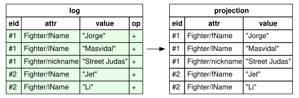
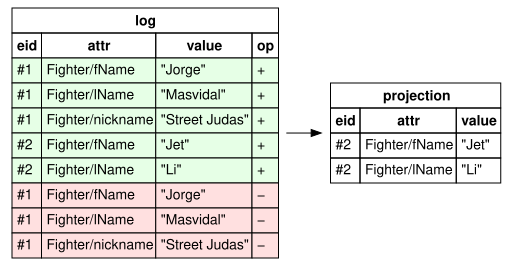
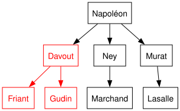
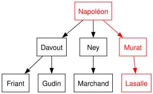

<div align="right">
  <sub><em>part of <a href="https://github.com/mattlianje/d4">c6</a></em></sub>
</div>

#  datomlite

**Lightweight, immutable database**

**datomlite** is a "DB-as-a-value" you can drop into your Haskell apps.

- Pure Haskell, zero-deps
- The `Db` is a plain immutable value
     - `commit` returns a new one
- Records are "the schema"
- Append-only log
     - Every past state stays queryable
- Queries are plain do-blocks, compile-time checked
     - Joins, refs, indexed lookups, negation, and recursive rules as recursive functions
- Easy time travel & speculative transactions
- IO only at the edge

```cabal
-- cabal.project
source-repository-package
  type:     git
  location: https://github.com/mattlianje/datomlite
  subdir:   datomlite-hs

-- your .cabal file
build-depends: datomlite
```

All you need:
```haskell
import Datomlite
```

Try it in your REPL:
```
cd datomlite-hs && cabal repl
```

## Contents
- [Quick start](#quick-start)
- [FAQ](#faq)
- [Updates](#updates)
- [Example schema](#example-schema)
- [Operations](#operations)
- [Keys and uniqueness](#keys-and-uniqueness)
- [Refs and cardinality](#refs-and-cardinality)
- [Value types](#value-types)
- [Optional fields](#optional-fields)
- [Tx blocks](#tx-blocks-batch-multiple-ops)
- [Queries](#queries)
  - [Do-block joins](#do-block-joins)
  - [Indexed lookups](#indexed-lookups)
  - [Typed fields](#typed-fields)
  - [Reverse refs](#reverse-refs)
  - [Aggregations](#aggregations)
  - [Sort and paging](#sort-and-paging)
- [Time travel](#time-travel-through-past-states)
- [History](#history-of-every-entity)
- [Diff](#diff-two-databases)
- [Negation](#negation-as-anti-join)
- [Existential subgoals](#existential-subgoals-semi-joins)
- [Rules](#rules)
  - [Recursive rules](#recursive-rules)
- [Sharing the db](#sharing-the-db-across-threads)
- [Listening and watching](#listening-and-watching)
- [Saving and restoring](#saving-and-restoring)
- [Build / Contribute](#build--contribute)

## Quick start

<details>
<summary>Pragmas and imports</summary>

```haskell
{-# LANGUAGE DeriveGeneric #-}
{-# LANGUAGE DeriveAnyClass #-}
{-# LANGUAGE DuplicateRecordFields #-}
{-# LANGUAGE OverloadedStrings #-}
{-# LANGUAGE OverloadedRecordDot #-}
{-# LANGUAGE DataKinds #-}
{-# LANGUAGE TypeApplications #-}
import Control.Monad (guard)
import Data.Text (Text)
import GHC.Generics (Generic)
import Datomlite
```

</details>

```haskell
import Datomlite

-- Just derive `Entity` on your records
data Person = Person { email :: Key Text, name :: Text }
  deriving (Show, Generic, Entity)

-- Start from `emptyDb`. A commit hands back the tx's result and a new db
Right ([matt, alice], db) =
  commit emptyDb $ traverse new [Person "m@x.io" "Matt", Person "a@x.io" "Alice"]

-- Your db feels like a collection
[ p.name | (_, p) <- loadAll @Person db ]   -- ["Matt","Alice"]
length (loadAll @Person db)                 -- 2
load alice db                               -- Just (Person ...)

-- Upsert by key
Right db' = commit_ db $ save (Person "m@x.io" "Matthieu")

-- Queries are plain do-blocks
query db' $ do
  p <- match @Person
  guard (p.email == "m@x.io")
  pure p.name
-- ["Matthieu"]

Right db'' = commit_ db' (retractEntity matt)
```

## FAQ

**Is the `Db` really a value?**<br>
Yes. A `Db` is an ordinary immutable Haskell value, `commit` is a pure
function, and a snapshot is just the value you already hold.

**What is it under the hood?**<br>
An append-only log of `(entity, attribute, value)` datoms, plus in-memory
indices over the live projection. `GHC.Generics` shreds your records into
datoms on write and puts them back together on read, so queries work with your
original typed records.

**What indices does it maintain?**<br>
**EAVT** for live entity reads and **AVET** for value lookups, both derived from
the log and updated in lockstep with each commit. `load` and `follow` are a map
lookup, and key checks are an AVET probe. `match @Employee` is a range scan
over the `Employee/…` attributes. `matchBy` is an AVET probe. `guard` filters
rows after they are produced, so reach for `matchBy` when you're matching a
field against a value.

**Does it support all of Datalog?**<br>
No. There is no Datalog engine. A query is a do-block in a list-like monad, so
joins are nested loops. Recursion is ordinary Haskell recursion, and it has no
fixed point, so a cyclic graph needs a visited set.

**Differences from Datomic / Datascript?**<br>
- Records are "the schema". There is no `:db/ident`, no attribute registration,
  and cardinality and uniqueness aren't separate facts.
- Queries are typed Haskell, not vectors of triples. The compiler checks every
  field access.
- Single process. No peer or transactor, no client API, and no wall-clock
  `txInstant` (yet).

**Transaction guarantees?**<br>
- **Atomicity.** All asserts and retracts in a `Tx` commit together or none do.
  A `UniqueViolation`, an `abort` or a failed pattern gives you a `Left`, and
  there is no new `Db` at all.
- **Purity.** `commit :: Db -> Tx a -> Either TxError (a, Db)`. The input `Db`
  is untouched, so there is nothing to lock.
- **Linearizable commits.** Writers to a `Conn` take turns: `commitIO` runs the
  whole `Tx` against the current db, evaluates it, then swaps it in, so each
  commit sees the one before it. A `Tx` that throws (say, an `error` in a
  field) throws at its `commitIO` and leaves the `Conn` as it was.
- **Snapshot reads.** A `Db` never changes; `dbOf` hands you one.

**What if I change a record?**<br>
Old datoms stay as they were, and `load` reads them back into the new type.
- Adding a `Maybe` or `Set` field is free: old entities read it as `Nothing`
  or empty.
- Adding a required field, or changing a field's type, makes the old entities
  unreadable as the new record. `load` throws a `LoadError` (`MissingField` or
  `BadValue`) naming the attribute and entity, rather than quietly skipping
  them.
- `load` gives `Nothing` only when the entity has no facts of that type at
  all, say a retracted entity or a record whose fields are all `Nothing`.

**What can be an entity?**<br>
A record with one constructor and named fields, since each field's name is its
attribute. A positional constructor, a sum type or a fieldless type is a type
error that says what to change.

**What's missing?**<br>
Pull, a storage engine (see [Saving and restoring](#saving-and-restoring)),
pretty-printing, composite keys, window functions and wall-clock time travel.

## Updates
Suppose we add two pugilists to our database, "Jet Li" and "Masvidal". Adding them appends datoms and the live projection picks them up:

```haskell
data Fighter = Fighter
  { fName    :: Text
  , lName    :: Text
  , nickname :: Maybe Text
  } deriving (Show, Generic, Entity)

Right ([masvi, _], db) = commit emptyDb $ traverse new
  [ Fighter "Jorge" "Masvidal" (Just "Street Judas")
  , Fighter "Jet"   "Li"       Nothing
  ]
```

<p align="center">
  
</p>

Unsurprisingly, we want to remove Masvidal:
```haskell
Right db' = commit_ db (retractEntity masvi)
map snd (loadAll @Fighter db')
-- [Fighter {fName = "Jet", lName = "Li", nickname = Nothing}]
```
The live projection drops Masvi, but the log still has every datom:
`history db'` holds all 8 (5 asserts, 3 retracts), and `datoms db'` holds Jet
Li's 2.

<p align="center">
  
</p>

## Example schema
We'll use these vanilla domain entities throughout for example purposes...

```haskell
data Department = Department { code :: Key Text, name :: Text }
  deriving (Show, Generic, Entity)

data Skill = Skill { name :: Key Text }
  deriving (Show, Generic, Entity)

data Order = Order { buyer :: Text, item :: Text, price :: Int }
  deriving (Show, Generic, Entity)

data Employee = Employee
  { email    :: Key Text
  , name     :: Text
  , dept     :: Ref Department
  , salary   :: Int
  , skills   :: Set (Ref Skill)
  , nickname :: Maybe Text
  } deriving (Show, Generic, Entity)
```

...and this db:

```haskell
Right (eng, db) = commit emptyDb $ do
  eng   <- new (Department "ENG" "Engineering")
  sales <- new (Department "SAL" "Sales")
  [scala, hs] <- traverse new [Skill "Scala", Skill "Haskell"]
  traverse_ new
    [ Employee "m@x.io" "Matt"  eng   120000 (Set.fromList [scala, hs]) (Just "Matty")
    , Employee "a@x.io" "Alice" eng   110000 (Set.singleton scala)      Nothing
    , Employee "b@x.io" "Bob"   sales 150000 mempty                     Nothing
    ]
  traverse_ new [Order "m@x.io" "book" 20, Order "a@x.io" "lamp" 90, Order "b@x.io" "chair" 60]
  pure eng
```

Records can share field names (`name` above) thanks to
`DuplicateRecordFields`: `e.name` knows which record it's reading, and
`setField` does the same for writes.

The snippets from here on assume these:

<details>
<summary>Pragmas and imports</summary>

```haskell
{-# LANGUAGE DeriveGeneric #-}
{-# LANGUAGE DeriveAnyClass #-}
{-# LANGUAGE DuplicateRecordFields #-}
{-# LANGUAGE OverloadedStrings #-}
{-# LANGUAGE OverloadedRecordDot #-}
{-# LANGUAGE DataKinds #-}
{-# LANGUAGE TypeApplications #-}
import Control.Applicative ((<|>))
import Control.Monad (guard, when)
import Data.Foldable (for_, traverse_)
import Data.List (sortOn, (\\))
import qualified Data.Map.Strict as Map
import Data.Ord (Down (..))
import Data.Set (Set)
import qualified Data.Set as Set
import Data.Text (Text)
import GHC.Generics (Generic)
import Datomlite
```

</details>

## Operations
Writes are steps in a `Tx`, and a commit applies them all-or-nothing.
Reads take a `Db` value, which never changes under you.

Write:
```
new r                  insert a record, returns its Ref (usable right away)
save r                 insert, or update the entity already holding r's Key
update ref f           change an entity with a function on its record
setField @"f" v        a record -> record function that sets field f
retractEntity ref      retract every fact the entity holds
commit db tx           Either TxError (result, db')
commit_ db tx          Either TxError db'
```

Read:
```
load ref db      Maybe a
loadAll @A db    [(Ref A, A)], in creation order
query db q       [a], run a Query
```

```haskell
-- Adding
Right (carol, db1) = commit db $ new (Employee "c@x.io" "Carol" eng 100000 mempty Nothing)
Right db2 = commit_ db1 $ traverse_ new
  [ Employee "d@x.io" "Dan" eng 90000 mempty Nothing
  , Employee "e@x.io" "Eve" eng 95000 mempty Nothing
  ]

-- Lookups
load carol db2                      -- Just (Employee ...)
map snd (loadAll @Employee db2)     -- [Employee]
query db2 $ do                      -- [Employee]
  e <- match @Employee
  guard (e.email == "m@x.io")
  pure (recordOf e)

-- Retract
Right db3 = commit_ db2 (retractEntity carol)

-- Quick checks: results are lists
not (null (query db3 (byEmail "m@x.io")))  -- True
length (loadAll @Employee db3)             -- 5
```

A `Query` is a value, so a reusable lookup is just a function. `matchBy` finds
the employee through the index instead of scanning them all:

```haskell
byEmail :: Text -> Query (Ref Employee)
byEmail em = refOf <$> matchBy @Employee @"email" em
```

A `Tx` hands back whatever its last step returns (`new` returns a `Ref`, and
`traverse new` returns a list of them). `basisT db'` names the transaction.

## Keys and uniqueness
Often, we want to enforce uniqueness of data in our datastore. To this end, a
field's type can mark it as a key:
```
Key a      unique identity (any number per record)
save r     find by key and write only the difference, same entity
ename      override the attribute prefix
```

A duplicate `Key` value, whether it clashes with the db or with another step of
the same `Tx`, fails with `UniqueViolation` and writes nothing.

```haskell
data User = User
  { email  :: Key Text
  , handle :: Key Text
  , name   :: Text
  } deriving (Show, Generic, Entity)

Right udb = commit_ emptyDb (new (User "a@x.io" "shared" "Alice"))

commit_ udb (new (User "b@x.io" "shared" "Bob"))
-- Left (UniqueViolation {uvAttr = "User/handle", uvValue = VText "shared"})
```

With `OverloadedStrings` a `Key` needs no wrapper; a bare literal is the key.
The check runs on the transaction's outcome, so retracting an entity and
reusing its key in the same `Tx` is fine.

`save` keeps the entity's identity, so every `Ref` to it stays valid. Back on
the example db:
```haskell
commit_ db (save (Department "ENG" "Platform"))
-- Matt's and Alice's dept now reads "Platform"
```

The same record name in two modules collides on the prefix. Override `ename`:
```haskell
instance Entity Person where ename _ = "a.Person"
```

## Refs and cardinality
Cardinality is a property of the field's type, not a separate declaration:

```
a          one datom
Maybe a    one datom on Just, nothing on Nothing
Set a      one datom per element
Ref t      one datom, value is the target's entity id
Key a      one datom, unique across the entity type
```

`Ref t` is a scalar like any other, so `Maybe (Ref t)` and `Set (Ref t)` just
work. A many-valued field is a `Set` (from `containers`), since the facts have
no order or duplicates; declaring one as `[a]` is a type error that says so.
`follow` walks a ref (a direct lookup), and `oneOf` ranges over a `Set` or
`Maybe` field:

```haskell
query db $ do
  e <- match @Employee
  d <- follow e.dept
  guard (d.name == "Engineering")
  s <- follow =<< oneOf e.skills
  pure (e.email, s.name)
-- [("m@x.io","Scala"),("m@x.io","Haskell"),("a@x.io","Scala")]
```

A ref field compares just as well against a `Ref` held outside the query:
`guard (e.dept == eng)`.

## Value types
A field holds one of these, bare or inside `Key`, `Maybe` or `Set`:

```
Text, Int, Integer, Double, Bool
ByteString        strict, from bytestring
UTCTime, Day      from time
Ref t             another entity
your enums        stored as the constructor's name
your newtypes     stored as the type they wrap
```

Enums and newtypes take one deriving line each:

<details>
<summary>Extra pragmas and imports</summary>

```haskell
{-# LANGUAGE DerivingStrategies #-}
{-# LANGUAGE GeneralizedNewtypeDeriving #-}
import Data.Time (Day)
```

</details>

```haskell
data Level = Junior | Senior
  deriving stock (Show, Eq, Ord, Generic)
  deriving anyclass (ToValue, FromValue)  -- "Junior" / "Senior"

newtype Email = Email Text
  deriving newtype (Show, Eq, Ord, ToValue, FromValue)

data Hire = Hire { email :: Key Email, level :: Level, started :: Day }
  deriving (Show, Generic, Entity)
```

`Ord` is only needed to put them in a `Set`. Renaming an enum's constructor
makes entities that hold the old name throw `BadValue` on read. A constructor
with fields can't derive `ToValue`, and the type error says to make it an
entity of its own and point at it with a `Ref`. A `NaN` behaves like any other
value: you can store it, match it and retract it.

## Optional fields
`Maybe a` writes a datom only on `Just`. `Nothing` is absence, not a stored
null.

```haskell
query db $ do
  e <- match @Employee
  guard (e.nickname == Just "Matty")
  pure e.email
-- ["m@x.io"]

query db $ do
  e <- match @Employee
  guard (e.nickname == Nothing)
  pure e.email
-- ["a@x.io","b@x.io"]
```

`oneOf` projects the inner value and emits a row only when it's present:

```haskell
query db $ do
  e <- match @Employee
  n <- oneOf e.nickname
  pure (e.email, n)
-- [("m@x.io","Matty")]
```

## Tx blocks: batch multiple ops
A `Tx` is a monad, so batching is a do-block:
```
do { new ..; update ..; save ..; retractEntity .. }   one tx
txDb              the in-progress db, earlier steps included
abort msg         give up with Aborted msg
Just x <- ...     a failed pattern aborts too (MonadFail)
commit db tx      apply a Tx value
```

Steps run in order against state-so-far, share one tx id, and commit
all-or-nothing.

```haskell
Right db' = commit_ db $ do
  now <- txDb
  for_ (query now (byEmail "m@x.io")) $ \r ->
    update r (setField @"name" "Matthieu")
  new (Order "m@x.io" "book" 20)
```

`update` writes only the difference, so a single-valued field is replaced
rather than given a second value. Any `a -> a` works: `setField` steps around
the ambiguity of `e { name = … }` when two records share `name`, and when a
field name is unique, plain record-update syntax is fine (see `balance`
below). `setField`s compose with `.`, and a `Key` field takes the bare value. Because `txDb` sees everything so far,
read-modify-write logic runs inside the transaction, atomically:

```haskell
data Account = Account { owner :: Key Text, balance :: Int }
  deriving (Show, Generic, Entity)

transfer :: Ref Account -> Ref Account -> Int -> Tx ()
transfer from to amount = do
  Just a <- load from <$> txDb   -- no such account: aborts
  when (a.balance < amount) $ abort "insufficient funds"
  update from (\x -> x { balance = x.balance - amount })
  update to   (\x -> x { balance = x.balance + amount })

Right ([alice, bob], adb) =
  commit emptyDb $ traverse new [Account "alice" 100, Account "bob" 0]

commit_ adb (transfer alice bob 30)   -- Right adb', alice 70 and bob 30
commit_ adb (transfer alice bob 500)
-- Left (Aborted "insufficient funds")
```

A `Tx` is just a value, so you can build one now and run it later:
```haskell
tx :: Tx ()
tx = traverse_ new [Order "m@x.io" "book" 20, Order "m@x.io" "pen" 5]

commit_ db tx
```

A failed transaction gives a `TxError`:
```
UniqueViolation attr value   a Key value held by two entities
UnknownEntity eid            update on an entity with no facts
Aborted msg                  abort, or a failed pattern
```

## Queries
A query is an ordinary do-block. The rest (`guard`, `==`, `pure`, `<|>`) is
plain Haskell. These words are new:
```
match @A              every entity of type A
matchBy @A @"f" v     the A's whose field f holds v, via the index
follow ref            the entity a Ref points at
oneOf xs              each value of a Set or Maybe field
exists q / none q     keep the row if subquery q has rows / has none
```

### Do-block joins
Stitch entities together on a shared field, with no DSL. Rows are whatever you
`pure`: a tuple, a record, a `Ref`.

```haskell
query db $ do
  e <- match @Employee
  o <- match @Order
  guard (o.buyer == e.email)
  pure (e.name, o.item)
-- [("Matt","book"),("Alice","lamp"),("Bob","chair")]
```

> [!NOTE]
> A `match` plus a `guard` is a nested loop. `follow` and `matchBy` are the
> exceptions: both are direct index lookups.

### Indexed lookups
`matchBy` names a record type and one of its fields, and gives you the
entities whose field holds a value. Its field name and value type are checked
like `e.name`. `Key`, `Maybe` and `Set` fields match on the value inside, and a
`Ref` field matches the entity it points at:

```haskell
query db $ do
  e <- match @Employee
  o <- matchBy @Order @"buyer" e.email
  pure (e.name, o.item)
-- [("Matt","book"),("Alice","lamp"),("Bob","chair")]

query db $ do
  s <- matchBy @Skill @"name" "Scala"
  e <- matchBy @Employee @"skills" (refOf s)
  pure e.name
-- ["Matt","Alice"]
```

A typo is caught at compile time: `datomlite: Employee has no field "emial"`.

### Typed fields
Record-dot on a matched entity reads the record's own field, so `e.emial` or
`e.name == 5` won't compile. Fields have their declared types (`e.nickname` is
a `Maybe Text`), except that `Key` is stripped: `e.email` is a `Text`.
`recordOf e` is the whole record, and `refOf e` is its `Ref`.

### Reverse refs
`refOf` is how you join the other way, from a department to the employees
pointing at it. With `matchBy` both steps are index lookups:

```haskell
query db $ do
  d <- matchBy @Department @"code" "ENG"
  e <- matchBy @Employee @"dept" (refOf d)
  pure e.name
-- ["Matt","Alice"]
```

### Aggregations
Results are lists, so rollups are plain Haskell over them:

```haskell
Map.fromListWith (+) $ query db $ do
  e <- match @Employee
  o <- matchBy @Order @"buyer" e.email
  pure (e.name, o.price)
-- fromList [("Alice",90),("Bob",60),("Matt",20)]
```

### Sort and paging
The same goes for ordering and slicing:

```haskell
take 2 . sortOn (Down . snd) $ query db $ do
  e <- match @Employee
  guard (e.salary > 100000)
  pure (e.name, e.salary)
-- [("Bob",150000),("Matt",120000)]
```

## Time travel through past states
Queries run on any `Db` value, so you can read any past state or branch off a
speculative transaction. Either way, the db you started from is untouched.

```
basisT db       the tx a db value reflects
asOf t db       rewind to tx t
since t db      only the facts added after tx t
db              a snapshot is the value you already hold
commit db tx    a what-if branch is a commit you don't keep
```

```haskell
names :: Query Text
names = do
  e <- match @Employee
  pure e.name

-- db' is db after the "Matthieu" rename from Tx blocks
query db' names                      -- ["Matthieu","Alice","Bob"]
query (asOf (basisT db) db') names   -- ["Matt","Alice","Bob"]
query (since (basisT db) db2) names  -- ["Carol","Dan","Eve"]
```

A `since` view holds only the newer facts, so an entity created before `t` and
changed after it is just a fragment there. Typed reads skip it and see the
entities that are whole within the window. Use `datoms` on the view to get
every fact.

Snapshot vs what-if:
```haskell
let whatIf = commit_ db2 (new (Employee "z@x.io" "Zed" eng 1 mempty Nothing))

length (loadAll @Employee db2)           -- 6
length . loadAll @Employee <$> whatIf    -- Right 7, includes Zed
length (loadAll @Employee db2)           -- 6, still
```

## History of every entity
`history` gives the full log of datoms, and `refId` ties a `Ref` to its trail.

```
history db             every datom, oldest first
datoms db              just the live facts
refId ref              a Ref's EntityId, to filter a trail by
```

Each `Datom` carries its tx and an `Assert` or `Retract`, and nothing is
overwritten. A trail survives retraction:

```haskell
[ (dAttr d, dValue d, dTx d, dOp d) | d <- history db3, dEntity d == refId carol ]
-- [ ("Employee/email",  VText "c@x.io",    TxId 2, Assert)
-- , ("Employee/name",   VText "Carol",     TxId 2, Assert)
-- , ("Employee/dept",   VRef (EntityId 1), TxId 2, Assert)
-- , ("Employee/salary", VInt 100000,       TxId 2, Assert)
-- , ("Employee/dept",   VRef (EntityId 1), TxId 4, Retract)
-- , ... ]
```

To go around the schema entirely, with stringly-typed `transact` and
`assert`/`retract` or index probes like `lookupValue` and `entitiesWith`,
import `Datomlite.Raw`. Raw writes skip typing and uniqueness checks, so reach
for it deliberately.

## Diff two databases
When your database is a value, you can diff it against another one, such as
the same database with a speculative transaction applied. An unchanged fact is
the same `Datom` in both, so a diff is list difference over `datoms`:

```haskell
-- db' is db after the Tx blocks example: a rename plus a new order
[ dValue d | d <- datoms db' \\ datoms db ]   -- added
-- [VText "Matthieu",VText "m@x.io",VText "book",VInt 20]
[ dValue d | d <- datoms db \\ datoms db' ]   -- retracted
-- [VText "Matt"]
```

## Negation as anti-join
`none` keeps a row only when a subquery comes back empty. The subquery runs
against the same db as the query around it, so this works unchanged on an
`asOf` or a what-if:

```haskell
-- employees with no orders
query db2 $ do
  e <- match @Employee
  none (matchBy @Order @"buyer" e.email)
  pure e.name
-- ["Carol","Dan","Eve"]
```

## Existential subgoals (semi-joins)
When writing queries, you often ask "does at least one such row exist?"
without wanting the matched row in your output. That's `exists`, which yields
one row however many matches there are:

```haskell
-- orders whose buyer exists as a registered Employee
query db $ do
  o <- match @Order
  exists (byEmail o.buyer)
  pure o.item
-- ["book","lamp","chair"]
```

## Rules
A rule is a function returning a `Query`. It is named and reusable, and a call
works anywhere in a do-block as if you'd inlined its body. `<|>` is Datalog
disjunction (either branch holds). A rule that calls itself is recursive.

### Recursive rules

Let's imagine we have a hierarchy of officers...
<p align="center">
  
</p>

```haskell
data Off = Off
  { officer :: Key Text
  , boss    :: Maybe (Ref Off)
  } deriving (Generic, Entity)

Right db = commit_ emptyDb $ do
  napoleon <- new (Off "Napoléon" Nothing)
  davout   <- new (Off "Davout"   (Just napoleon))
  ney      <- new (Off "Ney"      (Just napoleon))
  murat    <- new (Off "Murat"    (Just napoleon))
  _        <- new (Off "Friant"   (Just davout))
  _        <- new (Off "Gudin"    (Just davout))
  _        <- new (Off "Lasalle"  (Just murat))
  new (Off "Marchand" (Just ney))

-- a direct report, or anyone below one
subordinates :: Var Off -> Query (Var Off)
subordinates o = do
  s <- matchBy @Off @"boss" (refOf o)
  pure s <|> subordinates s

-- their boss, or anyone above them
bosses :: Var Off -> Query (Var Off)
bosses o = do
  b <- follow =<< oneOf o.boss
  pure b <|> bosses b

named :: Text -> Query (Var Off)
named = matchBy @Off @"officer"
```

**Subordinates of "Davout":**
<p align="center">
  
</p>

```haskell
query db $ do
  s <- subordinates =<< named "Davout"
  pure s.officer
-- ["Friant","Gudin"]
```

**"Lasalle"'s reporting line:**
<p align="center">
  
</p>

```haskell
query db $ do
  b <- bosses =<< named "Lasalle"
  pure b.officer
-- ["Murat","Napoléon"]
```

In SQL: recursive CTE.

```sql
WITH RECURSIVE ancestor(anc, desc) AS (
  SELECT boss, name FROM off WHERE boss IS NOT NULL
  UNION
  SELECT a.anc, o.name
  FROM ancestor a JOIN off o ON o.boss = a.desc
)
SELECT desc FROM ancestor WHERE anc = 'Napoleon';
```

> [!NOTE]
> This is plain recursion, not a fixed point, so it terminates on trees and
> DAGs. For graphs with cycles, carry a visited set.

## Sharing the db across threads
`Db` is a plain value, so pass it anywhere. When threads need to share one
current db, a `Conn` is a mutable cell holding it, and `commitIO` commits a
`Tx` atomically, with the **same** uniqueness checks as `commit`:

```
connect db          IO Conn
dbOf conn           IO Db, a snapshot
commitIO conn tx    IO (Either TxError a)
```

```haskell
conn <- connect emptyDb
Right matt <- commitIO conn $ do
  eng <- new (Department "ENG" "Engineering")
  new (Employee "m@x.io" "Matt" eng 120000 mempty Nothing)

now <- dbOf conn
load matt now  -- Just (Employee ...)
```

Everything else stays pure. Hand `now` to any function that reads.

## Listening and watching
A `Conn` holds its db in a `TVar`, so a subscriber is just a thread that waits
for the next commit. Writers never wait on subscribers:

```
listen conn f        IO (IO ()), f gets one TxReport per commit
watch conn q f       IO (IO ()), f gets q's result, up front and on change
awaitAfter conn t    STM Db, blocks until a commit newer than t
```

```haskell
stop <- listen conn $ \r ->
  putStrLn (show (trTxId r) <> ": " <> show (length (trDatoms r)) <> " datoms")

_ <- watch conn (length . loadAll @Employee) $ \n ->
  putStrLn (show n <> " employees")

stop   -- unsubscribe
```

- **In order, none missed.** Each subscriber sees commits in tx order. A
  listener that falls behind catches up from the log, one report per commit.
- **Isolated.** Callbacks run on the subscriber's own thread, so they may read
  or commit. An exception is reported on stderr and never reaches `commitIO`.
- **`watch` shows the latest result.** `q` runs on the newest db, so if commits
  land faster than `f` keeps up, it skips the results in between.
- **Asynchronous.** A callback may not have run yet when `commitIO` returns.
  To wait for a commit yourself, use `awaitAfter`. It is plain STM, so it
  composes with `orElse` and timeouts.

## Saving and restoring
The log is the database, so saving one means saving its datoms, and
`fromHistory` turns them back into a `Db`, past included. `Datom` has `Show`
and `Read` instances that round-trip, so a datom per line works as a file
format with no extra dependencies:

```
history db           [Datom], every fact, oldest first
fromHistory datoms   Db, rebuilt from them
```

<details>
<summary>Extra imports</summary>

```haskell
import System.IO (readFile')
```

</details>

```haskell
restore :: FilePath -> IO Db
restore path = fromHistory . map read . lines <$> readFile' path

-- open the log (an empty file for a new db), then append each commit to it
conn <- connect =<< restore "app.log"
stop <- listen conn $ \r -> appendFile "app.log" (unlines (map show (trDatoms r)))
```

A restored db picks up where the old one stopped: the same entities, the same
past for `asOf`, and new entity ids that never reuse one the log mentions.

- **`listen` is asynchronous**, so a crash right after a `commitIO` can lose
  the last commits. If each commit must be on disk before you move on, append
  `trDatoms` yourself after `commitIO` returns.
- **`Show` is simple, not fast.** For a big log, write your own encoding. Every
  `Datom`, `Value` and id constructor is exported (ids from `Datomlite.Raw`).

## Build / Contribute
PRs welcome, but please keep it to boot-library deps...
```
make build
make test
make repl
```
